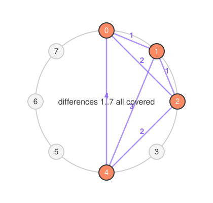
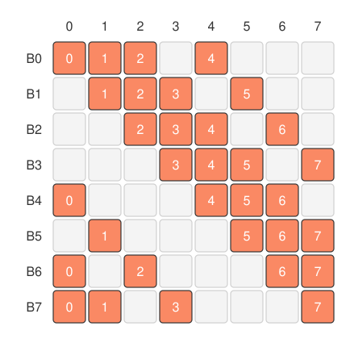
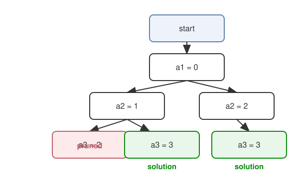
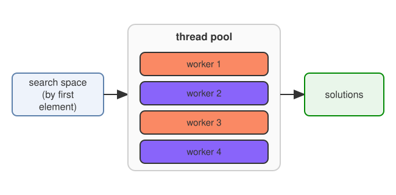

# Introduction

## The Coordination Problem

- Distributed algorithms must coordinate many independent sites
- In mutual exclusion, only one site may enter the critical section at a time
- We want **equal work**, **equal responsibility**, and a small quorum size to limit communication
- Finding optimal systems for arbitrary $N$ is a hard combinatorial problem

## Quorum Systems

- A quorum system is a family $\mathcal{Q}$ of subsets of the sites, called quorums
- **Intersection property:** $G \cap H \neq \emptyset$ for all $G, H \in \mathcal{Q}$
- Any two operations therefore meet at a common site, which permits conflict detection and resolution
- Maekawa: a symmetric system on $N$ sites needs quorum size $d$ with $d(d-1)+1 \ge N$, so $d \ge \lceil\sqrt{N}\rceil$
- Grid-based systems are simpler, but use quorums of size about $2\sqrt{N}-1$

## Cyclic Quorum Systems

- Fix a **base quorum** $B_0 = \{a_0, \dots, a_{d-1}\} \subseteq \{0, \dots, N-1\}$
- Generate every quorum by a cyclic shift: $B_i = \{a_0+i, \dots, a_{d-1}+i\} \pmod N$
- Equal work and equal responsibility then hold automatically
- A CQS is thus described by a single base quorum

## Difference Sets and Covers

:::: {.columns}
::: {.column width="58%"}
- A set $\{a_1, \dots, a_d\}$ is a cyclic $(N,d,\lambda)$-**difference set** if every non-zero residue occurs exactly $\lambda$ times as a difference
- A **relaxed** $(N,d)$-difference set requires every non-zero residue to occur at least once
- A base quorum yields a valid CQS exactly when it is a relaxed difference set
- A CQS also satisfies **rotation closure**: $G \cap (H+i) \neq \emptyset$ for all quorums $G, H$ and every shift $i$
- Singer difference sets exist when $N = d(d-1)+1$ with $d-1$ a prime power
:::
::: {.column width="42%"}
{width="100%"}
:::
::::

# An Example

## Building a CQS for $N = 8$

:::: {.columns}
::: {.column width="52%"}
- Base quorum $B_0 = \{0, 1, 2, 4\} \pmod 8$, of size $d = 4$
- Shifting cyclically:
  - $B_1 = \{1, 2, 3, 5\}$
  - $B_2 = \{2, 3, 4, 6\}$
  - $B_3 = \{3, 4, 5, 7\}$
  - $B_4 = \{4, 5, 6, 0\}$, $\dots$
- Each site occurs in four quorums, and any two quorums intersect
:::
::: {.column width="48%"}
{width="100%"}
:::
::::

# Finding Difference Covers

## The Difference Cover Problem

- Choose $d$ markers on a circle of $N$ points
- The pairwise distances must cover $1, \dots, N-1$ at least once
- Equivalent to a relaxed $(N, d)$-difference set with minimal $d$
- Assumptions: $N, d \ge 3$ and $N \le d(d-1)+1$

## Approach 1: Recursive Search

:::: {.columns}
::: {.column width="52%"}
- Build the set one element at a time (generate and test)
- Track which differences have already been covered
- **Prune** as soon as the remaining choices cannot cover all differences
- **Backtrack** at a dead end
- Guaranteed to find a solution within its search space
:::
::: {.column width="48%"}
{width="100%"}
:::
::::

## Symmetry Breaking

- Many base quorums are equivalent under rotation or reflection
- Enumerate them through **fixed-density necklaces** (rotation) and **bracelets** (rotation and reflection)
- Generation runs in **constant amortized time (CAT)**: total work is proportional to the number of outputs
- The bracelet algorithm handles arbitrary alphabet size, listing each bracelet once in lexicographic order
- Necklaces can be counted with **Burnside's lemma**; related objects are Lyndon words and De Bruijn sequences

## Parallel Search

:::: {.columns}
::: {.column width="52%"}
- Split the search by the value of the first element
- Each partition runs in its own thread from a thread pool
- All cores work simultaneously, greatly reducing wall-clock time
- Each candidate is validated by counting the distinct differences
:::
::: {.column width="48%"}
{width="100%"}
:::
::::

## Approach 2: Min-Conflicts Local Search

- Start from a random complete $d$-element set; a **conflict** is an uncovered residue
- The only swaps that can cover $r$ are $s \to s \pm r$, so the neighbourhood has size at most $2d$, not $O(N)$
- Apply the least-conflicts swap, **even when it worsens** the count: that is how the search leaves local optima
- Restart from a fresh random set after a plateau
- Incomplete, but every reported set is verified to cover all $N-1$ non-zero residues

## Local Search in Parallel

- The objective is cheap and the state is only $O(N)$ bytes, so workers never contend
- Each worker keeps its own difference counts, candidate set and random generator
- Workers share an atomic **stop flag** and one mutex for printing; the first to reach zero conflicts stops the rest
- No locks or atomics in the hot loop: evaluating a move touches only the pairs incident to the swapped elements

## Local Search: Results

| $N$ | $d$ | bound |
|----:|----:|------:|
| 151 | **15** | 13 |
| 152 | **15** | 13 |
| 160 | **15** | 13 |
| 171 | **16** | 14 |
| 182 | **16** | 14 |

- Every entry is within one or two of the bound $d(d-1)+1 \ge N$
- The full range $N = 151$ to $182$ is tabulated in the paper
- Each reported set is verified to cover all $N-1$ non-zero residues

## When $d = 14$ Is Impossible

| $N$ | certificate | time |
|----:|:------------|-----:|
| 182 | parity counting | instant |
| 181 | exhaustive search | 1 h 55 m |
| 180 | exhaustive search | 2 h 37 m |
| 179 | exhaustive search | 8 h 19 m |
| 178 | exhaustive search | 3 h 48 m |
| 177 | exhaustive search | 18 h 46 m |

- $N = 182$ is analytic: 91 pairs must cover 91 classes, and the parity split forces $2eo = 92$, hence $eo = 46$ with $e+o = 14$, which has no integer solution
- For $177 \le N \le 181$ parity is silent, and on odd $N$ it does not even apply; the exact search decides them
- No 14-element cover exists for $177 \le N \le 182$; $d = 15$ is open, 16 elements are the smallest known

## Comparison

- **Recursive search:** systematic, with explicit pruning; guaranteed within its search space
- **Local search:** conflict repair from a complete candidate; not guaranteed, but strongest beyond the exhaustive range
- Both exploit parallelism for speed
- The search can certify impossibility; the local search finds solutions
- The local search returns *a* solution, not all of them

# Applications

## Distributed Mutual Exclusion

- A site requests access from every member of its quorum
- The members check for conflicts; the site enters the critical section only when they agree
- The quorum size approaches $\sqrt{N}$
- The cyclic construction gives symmetry from a single base quorum

## Distributed All-Pairs Algorithms

- Each process stores only a quorum of the data
- **All-pairs property:** every pair of data sets occurs together in some quorum
- The quorum size grows as $O(\sqrt{P})$ in the number of processes $P$
- Reported: up to 7x speedup on 8 nodes with a 2/3 memory reduction
- Bian and Somani enumerate **all** cyclic quorum sets with the all-pairs property

## Wireless Sensor Networks

- Nodes have different power-saving requirements
- **CQS-Pair** combines two cyclic quorum systems with different cycle lengths
- It guarantees discovery within every $m$ consecutive slots
- This balances energy consumption against discovery delay

## Rendezvous and Neighbor Discovery

- Quorum schedules let two radios **rendezvous without a dedicated control channel**
- Used in cognitive-radio, Internet-of-Things, and underwater acoustic networks
- Meeting is guaranteed within a bounded number of slots

## Deep Learning and String Algorithms

- **CQS-Attention** scales self-attention to very long sequences
- It reduces the memory bottleneck of the standard computation
- **Suffix-array construction:** the DC3 algorithm samples positions by residue modulo 3
- It relies on the difference-cover property that any two positions share a small offset at which both are sampled

# Results

## Extending the Search

- Earlier work tabulates base quorums for $N = 4$ to $111$
- The recursive search extends the optimal base quorums to $N = 150$
- The resulting quorum size stays close to $\sqrt{N}$
- Beyond that, the min-conflicts local search gives the best known sets for $N = 151$ to $182$

## Optimal and Best-Known Base Quorums

- Optimal base quorums for $N = 112$ to $150$ (recursive search)
- Best known base quorums for $N = 151$ to $182$ (local search)
- $d = 14$ is impossible at $N = 181$ and $N = 182$; 16 elements are the smallest known there
- The complete tables are given in the paper

## Quorum Size vs. Lower Bound

| $N$ | $d$ | $\lceil\sqrt{N}\rceil$ | $d/\lceil\sqrt{N}\rceil$ |
|----:|----:|-----------------------:|-------------------------:|
| 112 | 12 | 11 | 1.09 |
| 120 | 13 | 11 | 1.18 |
| 130 | 13 | 12 | 1.08 |
| 140 | 14 | 12 | 1.17 |
| 150 | 14 | 13 | 1.08 |
| 160 | 15 | 13 | 1.15 |
| 171 | 16 | 14 | 1.14 |
| 182 | 16 | 14 | 1.14 |

- $N \le 150$: optimal (recursive search); $N > 150$: best known (local search)

# Implementation and Performance

## Symmetry Pruning

- The original search broke only rotation symmetry (necklaces)
- Adding the reflection test `CheckRev` reduces it to bracelets
- Reflection only helps near the symmetric frontier, so the gain is modest
- Measured speedup **1.07-1.17x**, with output identical to the reference solver (12 cases)

## Local-Search Engine

- Evaluate a candidate swap incrementally: only the pairs incident to the two swapped elements change
- Conflict count is updated in constant time per candidate, so a worker runs at tens of thousands of moves per second
- A few hundred moves typically suffice at $N = 151$
- Workers share nothing but an atomic stop flag, so the search scales linearly with cores

## Robustness

- The guard $N \le d(d-1)+1$ overflowed in 32-bit arithmetic; compute the product in 64-bit
- Fuzz the command line with degenerate and overflow inputs: all rejected cleanly
- Rebuild with bounds assertions enabled: no out-of-range access

## Performance Summary

| Change | Effect |
|:-------|:-------|
| Bracelet symmetry | 1.07-1.17x, identical output |
| Min-conflicts local search | d=15-16 at N=151-182 |
| Incremental conflict counts | tens of thousands of moves per second |
| Overflow-safe guard | no crashes |

# Conclusions

## Conclusions

- Optimal CQS reduce to finding relaxed $(N,d)$-difference sets
- A systematic recursive search is guaranteed and enumerates bracelets in CAT; optimal through $N = 150$
- A min-conflicts local search gives the best known base quorums for $N = 151$ to $182$, one or two above the bound
- The two methods are complementary: parity counting and the exhaustive search prove $d=14$ impossible at $N = 182$ and $N = 181$
- Both approaches exploit parallelism to handle the combinatorial search

## Future Work

- Close the remaining gap to the bound, or certify that it cannot be closed (tightest: $N = 151$ to $157$, bound 13)
- Decide whether $d = 15$ exists at $N = 181$ and $N = 182$
- Develop better pruning rules for the exhaustive search
- Count fixed-density prenecklaces
- Generate $k$-ary necklaces with fixed content for $k > 2$
- List other restricted classes of bracelets
