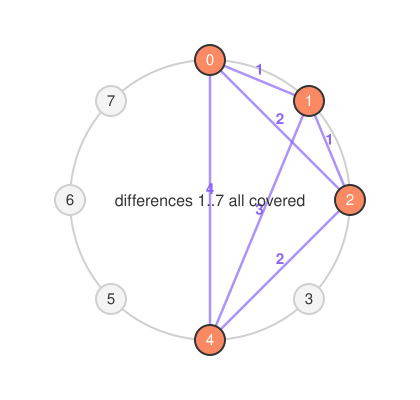
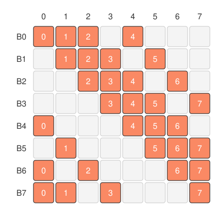
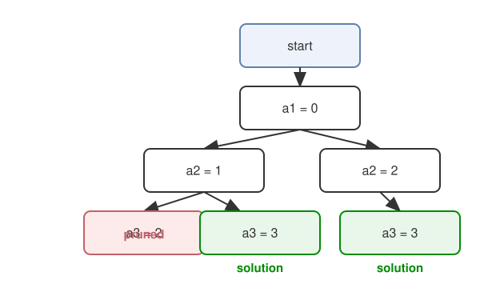
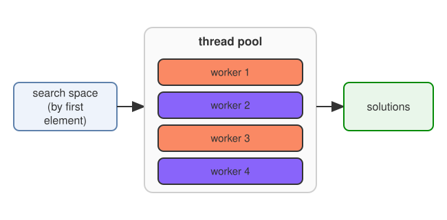

---
title: Finding Optimal Cyclic Quorum Systems by Combinatorial Search and Local Search
author: Wai-Shing Luk
bibliography:
  - cyclic_quorum.bib
documentclass: IEEEtran
abstract: |
  This paper studies two computational approaches to finding optimal Cyclic Quorum Systems (CQS). A CQS is a symmetric quorum system in which the whole family of quorums is generated by cyclically shifting a single base quorum, so that equal work and equal responsibility hold automatically. The central difficulty is to identify that base quorum, a problem equivalent to finding a difference cover, or relaxed difference set.

  The first approach is a systematic combinatorial search. It uses generate-and-test with pruning and backtracking, together with symmetry breaking inspired by algorithms for generating fixed-density necklaces and bracelets, and it is guaranteed to find a solution within its search space if one exists. The second approach repairs candidate sets directly with a min-conflicts local search over the cover condition, guided by a tabu list and a greedy starting rule. It is incomplete, but it is effective beyond the exhaustive range, and it yields the smallest base quorums currently known for $N = 151$ to $256$, never more than two elements above the counting bound.

  Both methods use parallelism to improve efficiency. The recursive search divides the search space into partitions, each handled by a separate thread, and the local search runs independent random restarts in parallel workers.
...

## Introduction

Distributed systems must coordinate many independent sites while using resources efficiently. A quorum system is one of the basic tools for this: it is a collection of subsets, called quorums, of the set of sites, in which any two quorums intersect. The intersection property guarantees that any two operations requiring a quorum meet at a common site, which makes conflict detection and resolution possible; it underlies applications such as mutual exclusion and the reliable processing of distributed data.

Designing quorum systems that are both fair and scalable, however, is difficult. Ideally each quorum has the same size (equal work) and each site occurs in the same number of quorums (equal responsibility), and the quorum size is as small as possible in order to reduce communication cost. For $N$ sites satisfying these symmetry conditions the quorum size is approximately $\sqrt{N}$. Attaining this bound is often equivalent to constructing a finite projective plane, and such planes do not exist for every order, so finding optimal quorums is a hard combinatorial problem.

**Cyclic quorum systems (CQS)** are a structured construction that often achieves, or comes close to, these properties. They draw on cyclic block designs and cyclic difference sets, and their defining feature is that the whole family of quorums is generated cyclically from a single base quorum, which simplifies both their description and their management.

Cyclic quorum systems are useful beyond their original application in distributed mutual exclusion. Recent work applies them to distributed all-pairs computations [@kleinheksel2016scaling; @kleinheksel2018efficient], to heterogeneous wakeup scheduling in wireless sensor networks [@lai2010heterogenous; @jiang2005quorum], and to sequence parallelism for attention computation in transformers [@bian2025cqs].

The main objective of this paper is to apply difference covers to the construction of optimal cyclic quorum systems. A difference cover is a set of numbers whose pairwise differences, taken modulo $N$, cover every non-zero residue at least once and, ideally, without excessive repetition; the problem is to select exactly $d$ numbers from $\{0, \dots, N-1\}$. Earlier work tabulated base quorums for optimal cyclic quorum schemes with $N$ from 4 to 111 using 1-based indexing; for consistency, this paper reports every base quorum with 0-based residues, extends the exact search to $N = 150$, and extends the tabulation itself to $N = 256$ with a local search.

This paper considers two computational approaches to finding these structures: a systematic recursive search and a min-conflicts local search that repairs candidate sets directly. Both use parallel processing.

The rest of the paper is organized as follows. Related work is reviewed next, after which we recall quorum systems and cyclic quorum systems, work through a small construction in detail, and survey applications. We then state the difference cover problem and present the two approaches---a combinatorial search and a local search---before comparing them, reporting implementation and performance, and concluding. The appendix details the fixed-density bracelet generator used for symmetry breaking.

## Related Work

Quorum systems coordinate distributed processes without global knowledge or central control, and permission-based mutual exclusion algorithms built on them are surveyed by Saxena and Rai [@saxena2003survey]. Maekawa's algorithm was among the first to pursue symmetry---equal work and equal responsibility---with a minimal quorum size, and it established the connection to finite projective planes [@maekawa1985]. Finding optimal symmetric quorums for arbitrary $N$, however, proved difficult.

Luk and Wong proposed using cyclic difference sets as the basis for quorum systems in distributed mutual exclusion [@luk1997two]. Their cyclic scheme constructs symmetric quorum sets for arbitrary $N$ with a quorum size very close to the theoretical lower bound $\sqrt{N}$. The construction studied in this paper is a direct descendant of that scheme, and its main computational challenge is to find the optimal base quorum, that is, a relaxed difference set.

Cyclic quorums have since been applied well beyond mutual exclusion: to distributed all-pairs computations [@kleinheksel2016scaling; @kleinheksel2018efficient], to heterogeneous wakeup scheduling in wireless sensor networks [@lai2010heterogenous], and to sequence parallelism for attention [@bian2025cqs]. More generally, quorum-based rendezvous and neighbor-discovery protocols are used in cognitive-radio, Internet-of-Things, and underwater acoustic networks [@bian2009quorum; @bian2011asynchronous; @bian2012maximizing; @pozza2015neighbor; @bouabdallah2018collision; @huang2025qdnd].

## Preliminaries

### Quorum Systems

A quorum system coordinates a distributed system without global knowledge or central control. Let $U = \{0, 1, \dots, N-1\}$ be the set of $N$ sites (or processes).

**Definition 1. Quorum System.**
A quorum system $\mathcal{Q}$ over $U$ is a collection of non-empty subsets of $U$, called quorums, which satisfies the **intersection property**: $G \cap H \neq \emptyset$ for all $G, H \in \mathcal{Q}$.

This property is essential: it guarantees that any two operations requiring a quorum consult at least one common site, which can mediate conflicts or ensure consistency [@saxena2003survey].

For distributed algorithms such as mutual exclusion, further properties are desirable for fairness and efficiency:

- **A1. Site Inclusion:** Each site $i$ is contained in its own quorum $S_i$.
- **A2. Non-empty Intersection:** Any two quorums must intersect. This is the defining property of a quorum system.
- **A3. Equal Work:** All quorums have the same size: $|S_i| = d$ for every site $i$, where $d$ is an integer with $3 \le d < N$.
- **A4. Equal Responsibility:** Each site is contained in the same number $d$ of quorums.

A set of quorums satisfying A3 and A4 is called **symmetric**. The goal in designing efficient quorum systems is to minimize the quorum size $d$ while maintaining these properties.

Maekawa showed that for a fixed quorum size $d$, the maximum number of sites for which a symmetric quorum system exists is $d(d-1) + 1$, assuming any two quorums intersect at exactly one site [@maekawa1985]. This implies a theoretical lower bound on the quorum size:
$d \geq \sqrt{N}$. More precisely, the lower bound is $\lceil \sqrt{N} \rceil$. Grid-based constructions are simpler to describe, but their quorums typically have size about $2\sqrt{N}-1$, roughly twice this bound.

Finding systems that satisfy these properties with a near-minimal size is difficult. For $N = d(d-1)+1$ the problem is equivalent to constructing a finite projective plane of order $d-1$, and such planes do not exist for every order (order 10, for instance). Exhaustive search is intractable for large $N$, which has motivated systematic constructions based on combinatorial designs such as difference sets.

The difficulty of finding optimal symmetric quorum systems for arbitrary $N$ highlights the value of structured constructions that exploit combinatorial structure, such as the cyclic quorum systems discussed next.

### Cyclic Quorum Systems

Cyclic quorum systems construct symmetric quorum systems from cyclic block designs and cyclic difference sets. Their defining feature is that the entire collection of quorums is obtained by cyclically shifting the elements of a single base quorum.

Let $U = \{0, 1, \dots, N-1\}$ be the set of $N$ sites, viewed as elements of the additive group $\mathbb{Z}_N$.

**Definition 2. Cyclic Quorum System.**
A group of cyclic quorums is a set of $N$ quorums $\{B_0, B_1, \dots, B_{N-1}\}$ where each quorum $B_i$ is derived from a base quorum $B_0 = \{a_0, a_1, \dots, a_{d-1}\} \subseteq \{0, 1, \dots, N-1\}$ by adding $i$ modulo $N$ to each element: $B_i = \{a_0 + i, a_1 + i, \dots, a_{d-1} + i\} \pmod N$.

For $\{B_0, \dots, B_{N-1}\}$ to be a valid quorum system it must satisfy the non-empty intersection property, $B_i \cap B_j \neq \emptyset$ for all $i, j \in \{0, \dots, N-1\}$. The cyclic construction automatically gives equal work ($|B_i| = d$ for every $i$) and equal responsibility (each element occurs in $d$ quorums).

A cyclic quorum system also satisfies the stronger **rotation-closure** property: for all quorums $G, H$ and every integer $i$, $G \cap (H + i) \neq \emptyset$, where $H + i$ denotes the cyclic shift of $H$ by $i$.

The existence and properties of cyclic quorum systems are deeply connected to the theory of **difference sets** [@hall1986combinatorial].

**Definition 3. Cyclic $(N, d, \lambda)$-Difference Set.**
A set $M = \{a_0, a_1, \dots, a_{d-1}\} \subseteq \{0, 1, \dots, N-1\}$ is called a cyclic $(N, d, \lambda)$-difference set if for every $m \not\equiv 0 \pmod N$, there are exactly $\lambda$ ordered pairs $(a_i, a_j)$ with $a_i, a_j \in M$ such that $a_i - a_j \equiv m \pmod N$.

A related concept, particularly relevant for CQS, is the relaxed difference set.

**Definition 4. Relaxed Cyclic $(N, d)$-Difference Set.**
A set $M = \{a_0, a_1, \dots, a_{d-1}\} \subseteq \{0, 1, \dots, N-1\}$ is called a relaxed (cyclic) $(N, d)$-difference set if for every $m \not\equiv 0 \pmod N$, there exists at least one ordered pair $(a_i, a_j)$ with $a_i, a_j \in M$ such that $a_i - a_j \equiv m \pmod N$.

More generally, a difference cover with parameters $(v, d, \lambda)$ is a multiset $D$ of elements of a finite abelian group $G$ in which every $z \in G$ occurs exactly $\lambda$ times as a non-trivial difference $z = x_i - x_j$ with $x_i, x_j \in D$. When $G$ is cyclic the cover is called cyclic, which is the case relevant here.

{width="60%"}

The connection between cyclic quorum systems and relaxed difference sets is standard. A set $B_0 = \{a_0, \dots, a_{d-1}\} \pmod N$ is a relaxed $(N, d)$-difference set if and only if the cyclic quorum set defined by $B_i = \{a_0 + i, \dots, a_{d-1} + i\} \pmod N$ satisfies the non-empty intersection property. The intuition is that the intersection property $B_i \cap B_j \neq \emptyset$ for all $i, j$ is equivalent to requiring that for every difference $m = j - i \pmod N$ there exist elements $a_u, a_v \in B_0$ such that $a_u + i \equiv a_v + j \pmod N$, which simplifies to $a_u - a_v \equiv j - i \equiv m \pmod N$. Thus every non-zero difference modulo $N$ must be formed by at least one pair of elements of the base quorum.

Finding a base quorum $B_0$ that forms a cyclic quorum system of minimum size $d$ is equivalent to finding a relaxed $(N, d)$-difference set with minimum $d$. For $N = d(d - 1) + 1$ with $d-1$ a prime power, the existence of cyclic $(N, d, 1)$-difference sets (Singer difference sets) is guaranteed, and these sets form cyclic quorum systems in which any two quorums intersect in exactly one site [@hall1986combinatorial]. Singer difference sets therefore lead to particularly efficient CQS with no redundancy in pair coverage. For other values of $N$, finding the optimal base quorum often requires exhaustive search, although the Multiplier Theorem can speed up the construction of certain difference sets by identifying primes $p$ under which multiplication permutes the elements of the set.

Examples of cyclic quorum systems and difference sets include:

- For $N=7$, the set $\{1, 2, 4\} \pmod 7$ is a cyclic $(7, 3, 1)$-difference set. This is a Singer difference set ($7 = 3(3 - 1) + 1$, and $3-1=2$ is a prime power). The cyclic quorums are $\{1, 2, 4\}$, $\{2, 3, 5\}$, $\{3, 4, 6\}$, $\{4, 5, 0\}$, $\{5, 6, 1\}$, $\{6, 0, 2\}$, $\{0, 1, 3\}$.
- For $N=8$, the set $\{0, 1, 2, 4\} \pmod 8$ is a base quorum. The quorums are $B_0 = \{0, 1, 2, 4\}$, $B_1 = \{1, 2, 3, 5\}$, $B_2 = \{2, 3, 4, 6\}$, $B_3 = \{3, 4, 5, 7\}$, $B_4 = \{4, 5, 6, 0\}$, $B_5 = \{5, 6, 7, 1\}$, $B_6 = \{6, 7, 0, 2\}$, $B_7 = \{7, 0, 1, 3\}$.
- Earlier work tabulated base quorums for optimal cyclic quorum schemes with $N$ from 4 to 111 using 1-based indexing, found through exhaustive search. For consistency, this paper reports every base quorum with 0-based residues; for example, the base quorums for $N=4$ and $N=10$ are $\{0, 1, 2\}$ and $\{0, 1, 2, 5\}$, respectively.

The existence of cyclic quorum systems with sizes close to the theoretical lower bound for arbitrary $N$, coupled with their symmetric properties, makes them attractive for managing distributed resources and computations.

## A Worked Example: A Cyclic Quorum System for N = 8

We construct a cyclic quorum system for $N = 8$ from the base quorum $B_0 = \{0, 1, 2, 4\} \pmod 8$, of size $d = 4$.
The full set of 8 quorums is generated by adding $i \in \{0, 1, \dots, 7\}$ modulo 8 to the elements of $B_0$:

- $B_0 = \{0, 1, 2, 4\} \pmod 8$
- $B_1 = \{0+1, 1+1, 2+1, 4+1\} \pmod 8 = \{1, 2, 3, 5\} \pmod 8$
- $B_2 = \{0+2, 1+2, 2+2, 4+2\} \pmod 8 = \{2, 3, 4, 6\} \pmod 8$
- $B_3 = \{0+3, 1+3, 2+3, 4+3\} \pmod 8 = \{3, 4, 5, 7\} \pmod 8$
- $B_4 = \{0+4, 1+4, 2+4, 4+4\} \pmod 8 = \{4, 5, 6, 0\} \pmod 8$
- $B_5 = \{0+5, 1+5, 2+5, 4+5\} \pmod 8 = \{5, 6, 7, 1\} \pmod 8$
- $B_6 = \{0+6, 1+6, 2+6, 4+6\} \pmod 8 = \{6, 7, 0, 2\} \pmod 8$
- $B_7 = \{0+7, 1+7, 2+7, 4+7\} \pmod 8 = \{7, 0, 1, 3\} \pmod 8$

These eight quorums form a cyclic quorum system for $N = 8$. Each has size 4 (equal work). Equal responsibility also holds: site 0 occurs in $B_0, B_4, B_6$ and $B_7$, that is, in four quorums, matching $d = 4$; by the cyclic construction the same is true of every site. Intersection can be checked on any pair, for instance $B_0 \cap B_1 = \{1, 2\} \neq \emptyset$.

{width="72%"}

The challenge is to find the base quorum $B_0$ for a given $N$ such that the resulting cyclic sets satisfy the intersection property and $d$ is minimal.

## Applications

Cyclic quorum systems and difference covers are used well beyond mutual exclusion.

**Distributed mutual exclusion.** A site requests access from every member of its quorum; the members check for conflicts, and the site enters the critical section only when they agree. The quorum size approaches $\sqrt{N}$, and the cyclic construction provides symmetry while requiring only one base quorum.

**Distributed all-pairs algorithms.** Each process stores only a quorum of the data, and the all-pairs property guarantees that every pair of data sets occurs together in some quorum. The quorum size grows as $O(\sqrt{N})$ in the number of processes $N$, which reduces memory substantially; reported experiments give up to a sevenfold speedup on eight nodes with a two-thirds reduction in memory [@kleinheksel2016scaling; @kleinheksel2018efficient; @bian2021efficient].

**Wireless sensor networks.** A variant called CQS-Pair combines two cyclic quorum systems with different cycle lengths to satisfy a heterogeneous rotation-closure property, so that nodes with different power-saving requirements are guaranteed to discover one another within every $m$ consecutive slots. This balances energy consumption against discovery delay [@lai2010heterogenous].

**Attention in deep learning.** CQS-Attention applies the same theory to scale the standard self-attention computation to very long sequences, easing the memory bottleneck [@bian2025cqs].

**String algorithms.** Difference covers also underlie linear-time suffix-array construction: the DC3 algorithm samples positions by residue modulo 3 and uses the difference-cover property that any two positions share a small offset at which both are sample positions, which makes the comparison and merging steps efficient [@karkkainen2006linear; @mehnert2024scalable].

## The Difference Cover Problem

Given the range $0$ to $N-1$ and a required size $d$, the problem is to choose $d$ numbers such that the positive differences between every pair, taken modulo $N$, include every value from $1$ to $N-1$ at least once. Equivalently, place $d$ markers on a circle of $N$ points so that the pairwise distances cover every distance around the circle.

We assume throughout that $N, d \ge 3$ and that $N \le d(d-1)+1$.

## Combinatorial Search

The first approach is a **systematic algorithm** for finding difference covers, following a **generate-and-test strategy with pruning**. Solutions are **built incrementally**, one number at a time. Whenever a number is added, the algorithm computes its differences with the numbers already chosen and updates the set of differences seen so far.

### Search with Pruning and Backtracking

A critical technique is **backtracking**: when the algorithm reaches a **dead end**---a partial solution that cannot lead to a valid complete solution---it undoes the last choice and tries a different one. The `StepForward` and `StepBackward` routines maintain the difference counts as the search descends and backtracks through the space.

**Optimization** avoids spending time on impossible partial solutions. Before descending further, the algorithm checks whether the partial set can still cover enough distinct differences to reach a valid complete solution; if not, the branch is pruned. Two structures track coverage: an array recording, for each residue, how often it has been produced, and a counter of how many distinct residues have been covered. The difference of an element with itself is 0 and is covered from the outset.

Concretely, when a new element $a_t$ is appended, `StepForward` compares it with each previously chosen element $a_j$ ($j < t$), computes the two distances $a_t - a_j$ and $N - (a_t - a_j)$, and records the smaller one; the distinct-difference counter is incremented the first time a distance appears. `StepBackward` mirrors this, decrementing the counts when the element is removed and restoring the state that preceded its insertion.

Symmetry between mirror images is removed by a reflection test. The acceptance test is applied when $d-1$ elements have been placed: the final element is forced, and the configuration is reported only if the distinct differences cover every non-zero residue. Because a difference $m$ and its complement $N-m$ arise from the same pair in opposite order, it suffices to track distances up to $N/2$; covering all of them covers every non-zero difference modulo $N$.

{width="85%"}

```{=latex}
\begin{algorithm*}[t]
\caption{Recursive search for a difference cover}
\begin{algorithmic}[1]
\Function{Search}{$N, d$}
  \State $a[1] \gets 0$;\quad $\mathit{cnt} \gets 0$;\quad $\mathit{diff}[\cdot] \gets 0$;\quad $\mathit{diff}[0] \gets 1$
  \State \Call{Recurse}{$1, 1$}
\EndFunction
\Function{Recurse}{$t, \mathit{cnt}$}
  \If{$t = d$}
    \State \Call{Report}{$a$};\quad \Return
  \EndIf
  \For{$v \gets a[t] + 1$ \textbf{to} $N - d + t + 1$}
    \State $a[t+1] \gets v$
    \State $\mathit{cnt}' \gets \Call{StepForward}{t+1, \mathit{cnt}}$
    \If{$\mathit{cnt}' + \mathit{free}(t+1) \ge N-1$} \Comment{coverage bound: else prune}
      \If{$\Call{CheckRev}{t+1} \ne -1$} \Comment{reflection symmetry}
        \State \Call{Recurse}{$t+1, \mathit{cnt}'$}
      \EndIf
    \EndIf
    \State \Call{StepBackward}{$t+1$}
  \EndFor
\EndFunction
\Function{StepForward}{$t, \mathit{cnt}$}
  \For{$j \gets 1$ \textbf{to} $t-1$}
    \State $\delta \gets \min\bigl(a[t]-a[j],\ N-(a[t]-a[j])\bigr)$
    \If{$\mathit{diff}[\delta] = 0$} \State $\mathit{cnt} \gets \mathit{cnt} + 1$ \EndIf
    \State $\mathit{diff}[\delta] \gets \mathit{diff}[\delta] + 1$
  \EndFor
  \State \Return $\mathit{cnt}$
\EndFunction
\end{algorithmic}
\end{algorithm*}
```

### Symmetry Breaking by Bracelet Generation

The reflection test is the fixed-density **bracelet** condition. A candidate base quorum corresponds to a binary string of length $N$ with $d$ non-zero positions; its rotations form a necklace, and its rotations together with its reversal form a bracelet. Enumerating one representative per rotation class (a necklace) removes rotational duplicates, and enumerating one per rotation-and-reflection class (a bracelet) additionally removes reflected duplicates. To do so without losing the efficiency of the search, we use a generator of fixed-density bracelets that runs in **constant amortized time (CAT)**, so the symmetry test adds no asymptotic overhead; it merges the fixed-density necklace construction of Ruskey and Sawada with the bracelet construction of Sawada, and is summarized in Appendix A. Reflection symmetry only helps near the symmetric frontier of the search, so the measured speedup is modest.

### Parallel Search

The search is accelerated by a **thread pool**. Different threads start from different values of the first non-zero element, partitioning the search space; each worker runs an independent depth-first search on its partition and reports any solution it finds. Multiple cores therefore work on disjoint partitions simultaneously, and the main thread waits for the workers to complete, displaying a countdown of outstanding tasks.

{width="85%"}

### Results: Optimal Base Quorums

The recursive search is **exact**: within its search space it returns a solution whenever one exists, using explicit pruning rules derived from the coverage lower bound, and the returned base quorum is therefore optimal. Table I lists the optimal base quorums found for $N = 112$ to $150$; these extend, with 0-based residues, the earlier tabulation for $N = 4$ to $111$.

```{=latex}
\begin{table*}[t]
\centering
\caption{Optimal base quorums for $N = 112$ to $150$, using 0-based residues.}
\begin{tabular}{rl}
\hline
N & Base quorum \\
\hline
112 & 38 51 55 61 63 75 80 89 96 107 110 111 \\
113 & 46 48 60 67 75 78 86 89 102 106 111 112 \\
114 & 56 59 63 67 71 75 79 80 85 110 111 112 113 \\
115 & 57 60 64 68 72 76 80 81 86 111 112 113 114 \\
116 & 57 60 63 67 71 75 79 83 88 112 113 114 115 \\
117 & 37 43 50 51 55 68 70 79 90 100 113 116 \\
118 & 57 60 62 63 68 74 89 94 98 107 114 116 117 \\
119 & 57 59 64 69 77 85 93 101 109 112 115 116 118 \\
120 & 54 55 65 67 74 81 89 96 113 114 117 118 119 \\
121 & 59 61 66 71 79 87 95 103 111 114 117 118 120 \\
122 & 54 60 61 68 71 78 90 94 106 110 115 119 121 \\
123 & 53 55 69 72 74 83 89 96 106 114 118 121 122 \\
124 & 53 58 70 74 78 85 92 98 111 120 121 122 123 \\
125 & 54 59 71 75 80 86 93 99 113 121 122 123 124 \\
126 & 49 51 55 61 64 81 86 91 102 109 110 124 125 \\
127 & 53 59 63 75 77 82 90 105 115 116 122 125 126 \\
128 & 52 56 62 65 67 77 91 99 100 107 108 126 127 \\
129 & 49 57 58 64 67 87 92 97 109 111 113 124 128 \\
130 & 46 50 58 60 71 84 89 90 99 106 123 126 129 \\
131 & 55 57 69 76 84 87 96 104 107 120 124 129 130 \\
132 & 65 68 71 75 79 83 87 91 95 100 128 129 130 131 \\
133 & 47 56 57 64 77 89 92 103 108 126 130 132 \\
134 & 66 68 72 75 81 91 101 111 121 125 128 129 132 133 \\
135 & 67 70 71 75 78 88 98 108 118 120 127 132 133 134 \\
136 & 67 70 72 76 79 89 99 109 119 120 127 133 134 135 \\
137 & 68 71 73 77 80 90 100 110 120 121 128 134 135 136 \\
138 & 64 68 75 82 92 102 112 122 125 128 131 133 134 137 \\
139 & 64 71 72 78 79 89 99 109 119 122 131 133 135 138 \\
140 & 61 66 78 82 86 90 97 104 110 127 136 137 138 139 \\
141 & 67 74 78 85 95 105 115 125 128 131 134 137 139 140 \\
142 & 62 65 79 81 83 91 94 103 106 133 134 139 140 141 \\
143 & 56 71 76 77 90 94 98 102 106 130 132 139 141 142 \\
144 & 55 65 66 68 75 83 97 105 113 117 119 138 140 143 \\
145 & 58 67 68 78 85 89 93 97 101 125 138 139 141 144 \\
146 & 58 65 70 78 79 89 92 98 102 127 128 143 144 145 \\
147 & 63 65 77 84 92 95 103 112 120 123 136 140 145 146 \\
148 & 55 60 61 79 87 94 105 109 111 125 134 137 146 147 \\
149 & 55 60 62 76 89 100 106 112 115 125 135 143 147 148 \\
150 & 50 62 65 68 69 95 97 105 110 118 127 129 143 149 \\
\hline
\end{tabular}
\end{table*}
```

## Min-Conflicts Local Search

The cover condition is cheap to evaluate, so a candidate base quorum can be *repaired* directly rather than built up incrementally. We apply a **min-conflicts** local search in the style of the heuristic-repair methods for constraint satisfaction [@minton1992minimizing], with a tabu list that keeps it from undoing its own moves and a greedy rule for the initial placement.

A candidate is any $d$-element set $S \subseteq \mathbb{Z}_N$. A **conflict** is an uncovered residue, that is, a value $r \neq 0$ that is not the difference of any two elements of $S$. The search repeatedly picks one conflict $r$ uniformly at random and considers the swaps $s \to x$ with $x \equiv s \pm r \pmod N$ for $s \in S$; these are the only swaps that can cover $r$, so the neighbourhood is of size at most $2d$ rather than $O(N)$. Among the candidates the search applies the one that minimises the number of remaining conflicts, and it applies it even when that number increases, which is what allows the search to leave local optima. A **tabu list** forbids re-inserting a value that was just removed for the next $4 + \mathrm{rand}(d)$ moves, so the search cannot immediately undo its own move; a move that lowers the best conflict count seen so far is accepted even when it is tabu (aspiration), and when every candidate is tabu the least-conflicted tabu move is taken rather than stalling. After a fixed number of non-improving moves the worker restarts.

Two starting rules are used. A **cold start** places the $d$ elements greedily, each at a position that covers the most still-uncovered classes, and then repairs. A **warm start** begins from a cover of the same $N$ with one element too many, drops that element, and repairs the resulting $d$-element near-cover. The greedy rule is what keeps the search working near the top of the range, where a uniformly random start stalls; the warm rule is what settled $N = 218$.

Because the objective is cheap and the whole state is $O(N)$ bytes, the method parallelises without contention: each worker keeps its own array of difference counts, its own candidate set, its own tabu list and its own random generator, and the workers share only an atomic stop flag and a mutex that serialises output. The first worker to reach zero conflicts stops the rest. The search is **incomplete**: any set it reports covers every non-zero residue, but failing to find a set of a given size is not a proof that none exists.

Tables II to IV list the smallest sets found for $N = 151$ to $256$, one per $N$, with the number of elements in each column $d$; every entry was checked to cover all $N-1$ non-zero residues. The sets need 15 or 16 elements up to $N = 195$, 17 elements from $N = 196$, and 18 or 19 from $N = 219$, with $N = 220$ still holding a 17-element set. Throughout, $d$ exceeds the counting bound $d(d-1)+1 \ge N$ by one or two. $N = 183$ is the exception and is left out: there the Singer difference set supplies $d = 14$ outright.

```{=latex}
\begin{table*}[t]
\centering
\small
\caption{Smallest base quorums found by the local search for $N = 151$ to $195$, with 0-based residues. The column $d$ gives the number of elements. Each set covers every non-zero residue modulo $N$; none is known to be optimal.}
\begin{tabular}{rrl}
\hline
$N$ & $d$ & Base quorum \\
\hline
151 & 15 & 0 2 14 29 66 68 74 75 85 88 98 111 116 132 136 \\
152 & 15 & 0 2 4 19 28 43 46 66 76 77 98 127 133 135 140 \\
153 & 15 & 0 22 26 42 45 59 82 86 92 97 110 121 122 129 131 \\
154 & 15 & 0 1 6 20 47 69 71 78 93 100 106 110 118 121 144 \\
155 & 15 & 0 1 14 15 31 67 86 87 89 94 122 126 132 135 144 \\
156 & 15 & 0 8 16 24 26 53 76 82 85 96 97 101 118 125 131 \\
157 & 15 & 0 7 12 34 52 54 60 75 91 119 121 128 140 153 154 \\
158 & 15 & 0 12 26 43 44 68 78 96 108 111 127 141 147 149 154 \\
159 & 15 & 0 7 23 36 44 46 48 49 60 66 81 100 109 128 136 \\
160 & 15 & 0 3 5 19 40 49 69 79 80 93 97 105 111 120 127 \\
161 & 15 & 0 4 32 41 56 57 78 90 100 107 118 120 121 126 138 \\
162 & 15 & 0 10 21 30 48 49 52 65 81 89 135 136 142 147 149 \\
163 & 15 & 0 5 14 28 30 34 37 49 80 82 104 112 140 150 151 \\
164 & 15 & 0 5 9 17 20 22 23 44 51 70 75 105 107 115 148 \\
165 & 15 & 0 17 24 27 36 42 73 80 81 94 105 110 114 116 142 \\
166 & 15 & 0 17 22 48 49 56 59 85 103 117 123 126 136 138 142 \\
167 & 15 & 0 2 15 29 36 37 48 54 78 98 101 110 114 124 129 \\
168 & 16 & 0 11 14 32 45 55 66 78 86 110 125 126 151 155 160 162 \\
169 & 15 & 0 5 11 16 35 49 52 53 75 103 140 142 149 159 161 \\
170 & 15 & 0 4 17 19 20 25 28 32 55 65 88 99 117 131 148 \\
171 & 16 & 0 8 18 19 32 47 50 52 88 89 95 133 150 154 163 167 \\
172 & 16 & 0 2 5 8 16 20 70 88 98 107 111 121 128 143 145 146 \\
173 & 15 & 0 10 34 41 63 69 76 101 109 134 153 156 157 162 171 \\
174 & 16 & 0 8 10 28 31 40 44 66 73 79 90 108 127 132 133 147 \\
175 & 15 & 0 2 24 41 45 59 79 87 119 148 149 152 162 163 168 \\
176 & 16 & 0 17 19 20 25 34 36 47 79 89 110 115 128 135 160 172 \\
177 & 16 & 0 11 33 46 56 59 60 75 80 87 89 117 119 125 142 159 \\
178 & 16 & 0 7 13 16 26 72 76 94 105 106 108 127 142 147 150 167 \\
179 & 16 & 0 3 12 27 28 50 52 59 63 69 124 138 153 158 161 167 \\
180 & 16 & 0 8 21 29 48 61 77 79 83 84 91 94 103 128 141 169 \\
181 & 16 & 0 5 7 15 16 26 51 76 88 101 110 141 155 158 164 168 \\
182 & 16 & 0 10 42 56 63 68 91 107 113 115 118 122 134 138 151 152 \\
184 & 16 & 0 19 32 41 71 86 91 107 129 133 135 136 143 147 160 170 \\
185 & 16 & 0 29 38 42 52 62 64 66 68 69 100 111 119 129 144 165 \\
186 & 16 & 0 4 8 13 30 32 46 49 72 103 138 147 148 153 158 165 \\
187 & 16 & 0 1 5 11 25 34 44 46 59 62 69 101 109 139 161 175 \\
188 & 16 & 0 6 11 15 21 33 54 69 103 119 122 147 148 162 179 186 \\
189 & 16 & 0 6 20 21 25 43 46 52 59 76 87 88 130 135 137 145 \\
190 & 16 & 0 4 12 30 46 66 67 105 107 111 114 116 124 138 139 167 \\
191 & 16 & 0 10 13 20 29 40 60 64 65 82 97 103 105 131 143 145 \\
192 & 16 & 0 5 39 40 48 63 92 105 107 109 119 125 130 137 156 159 \\
193 & 16 & 0 1 6 9 16 29 53 78 96 100 117 134 136 137 148 167 \\
194 & 16 & 0 2 6 7 22 28 72 85 102 110 119 129 147 158 161 170 \\
195 & 16 & 0 3 4 11 49 60 86 101 106 115 118 128 134 136 152 159 \\
\hline
\end{tabular}
\end{table*}
```

```{=latex}
\begin{table*}[t]
\centering
\small
\caption{Smallest base quorums found by the local search for $N = 196$ to $241$ (continued from the previous table), with 0-based residues. From $N = 196$ the sets have 17 or 18 elements; none is known to be optimal.}
\begin{tabular}{rrl}
\hline
$N$ & $d$ & Base quorum \\
\hline
196 & 17 & 0 9 23 44 66 72 96 106 108 122 125 126 128 133 141 164 173 \\
197 & 17 & 0 12 15 19 55 61 93 102 103 112 114 116 119 127 141 147 179 \\
198 & 17 & 0 6 15 16 20 28 33 49 60 90 96 125 127 149 152 156 175 \\
199 & 17 & 0 9 24 32 38 48 59 87 90 95 100 102 119 120 124 146 164 \\
200 & 17 & 0 12 33 57 67 87 103 105 106 112 143 148 156 165 171 175 186 \\
201 & 17 & 0 3 13 17 43 45 50 61 70 100 106 107 126 129 141 149 180 \\
202 & 17 & 0 28 42 55 58 87 111 116 118 136 157 159 165 176 180 192 193 \\
203 & 17 & 0 2 14 34 38 58 87 109 126 136 144 161 177 191 192 194 198 \\
204 & 17 & 0 16 17 28 35 48 54 80 81 90 95 98 120 122 124 181 183 \\
205 & 17 & 0 16 24 25 32 34 38 69 80 92 109 137 139 142 158 163 178 \\
206 & 17 & 0 16 18 19 22 44 52 59 83 90 99 104 110 122 139 149 152 \\
207 & 17 & 0 16 42 45 54 56 109 113 116 137 138 144 152 157 174 184 189 \\
208 & 17 & 0 6 7 10 15 28 43 56 60 76 87 99 101 111 141 151 189 \\
209 & 17 & 0 19 23 44 45 52 55 61 75 109 114 125 132 160 172 185 187 \\
210 & 17 & 0 15 27 37 42 67 71 92 102 105 116 118 124 125 141 164 182 \\
211 & 17 & 0 16 23 31 44 48 50 84 87 136 154 165 166 176 187 196 201 \\
212 & 17 & 0 17 32 33 57 71 90 100 106 127 140 181 182 184 186 193 204 \\
213 & 17 & 0 1 31 43 45 53 66 72 77 81 92 140 156 159 189 193 196 \\
214 & 17 & 0 2 5 6 21 31 59 86 94 106 108 156 168 177 179 184 201 \\
215 & 17 & 0 4 9 20 23 33 43 54 79 80 86 88 113 116 128 180 197 \\
216 & 17 & 0 6 10 23 53 74 75 79 86 88 95 114 124 129 132 156 191 \\
217 & 17 & 0 9 28 34 45 55 60 68 71 98 112 116 118 140 147 151 152 \\
218 & 17 & 0 4 7 15 38 54 55 74 80 98 126 147 156 159 161 169 188 \\
219 & 18 & 0 13 31 34 36 37 39 56 66 84 123 125 137 170 177 181 185 186 \\
220 & 17 & 0 1 12 36 51 52 54 57 61 74 84 98 127 142 153 161 192 \\
221 & 18 & 0 25 29 34 37 42 44 47 69 70 95 119 125 141 162 179 182 193 \\
222 & 18 & 0 2 32 33 73 97 100 106 116 123 136 144 148 162 182 193 202 217 \\
223 & 18 & 0 12 15 22 30 60 76 85 100 119 132 160 161 168 198 212 214 218 \\
224 & 18 & 0 2 3 21 45 62 67 77 87 135 146 169 173 174 175 182 196 208 \\
225 & 18 & 0 2 40 56 65 75 83 97 114 117 121 142 147 159 165 176 212 213 \\
226 & 18 & 0 14 31 38 51 54 57 60 93 101 116 121 126 127 128 142 146 174 \\
227 & 18 & 0 7 26 31 76 89 92 93 122 129 130 132 144 150 153 164 180 209 \\
228 & 18 & 0 1 10 18 25 28 41 70 74 92 104 113 118 124 172 191 193 195 \\
229 & 18 & 0 20 25 35 51 81 87 91 98 109 110 137 151 184 186 192 195 216 \\
230 & 18 & 0 3 8 16 31 68 85 89 115 123 155 185 187 194 204 205 211 218 \\
231 & 18 & 0 15 18 51 59 82 104 105 118 134 138 144 151 153 165 176 181 225 \\
232 & 18 & 0 8 11 35 38 40 44 56 81 98 107 138 156 159 166 178 179 193 \\
233 & 18 & 0 2 9 28 41 45 51 81 97 105 141 163 168 185 188 199 200 206 \\
234 & 18 & 0 21 34 39 52 72 78 119 121 141 148 166 169 178 179 183 194 202 \\
235 & 18 & 0 28 55 56 66 78 115 118 120 136 153 161 167 174 187 191 197 206 \\
236 & 18 & 0 3 4 13 25 88 90 98 112 117 123 128 143 156 160 179 190 197 \\
237 & 18 & 0 1 6 11 20 29 42 72 84 86 118 144 147 151 198 200 213 221 \\
238 & 18 & 0 1 8 20 29 98 108 113 124 137 139 147 161 164 178 194 196 200 \\
239 & 18 & 0 11 36 53 56 76 116 123 124 128 134 142 155 157 179 185 192 201 \\
240 & 18 & 0 3 28 32 33 39 44 71 78 87 95 97 110 118 132 152 167 170 \\
241 & 18 & 0 1 5 11 30 32 39 54 72 80 110 124 170 171 175 184 187 207 \\
\hline
\end{tabular}
\end{table*}
```

```{=latex}
\begin{table*}[t]
\centering
\small
\caption{Smallest base quorums found by the local search for $N = 242$ to $256$ (continued from the previous table), with 0-based residues. From $N = 242$ the sets have 18 or 19 elements; none is known to be optimal.}
\begin{tabular}{rrl}
\hline
$N$ & $d$ & Base quorum \\
\hline
242 & 18 & 0 1 13 17 31 36 39 63 78 88 131 133 142 162 174 209 215 222 \\
243 & 19 & 0 9 10 11 41 46 95 108 124 151 163 173 177 180 193 195 201 218 220 \\
244 & 18 & 0 3 51 61 72 84 85 89 112 115 134 144 150 152 159 191 205 211 \\
245 & 19 & 0 7 18 19 23 31 68 70 90 125 147 150 164 176 178 179 185 212 222 \\
246 & 18 & 0 4 7 33 45 76 93 109 126 133 139 141 155 166 175 176 194 199 \\
247 & 18 & 0 5 17 42 51 74 87 90 127 128 134 139 146 154 156 158 168 189 \\
248 & 19 & 0 6 7 63 81 107 117 128 130 139 149 160 176 190 191 207 210 215 219 \\
249 & 19 & 0 48 63 89 113 121 129 140 141 146 161 163 190 193 200 231 235 236 245 \\
250 & 19 & 0 3 14 23 29 33 50 77 78 110 112 118 125 134 171 176 183 201 214 \\
251 & 19 & 0 8 31 44 47 53 57 58 68 109 110 143 150 175 184 204 221 223 239 \\
252 & 19 & 0 1 3 11 20 32 70 84 104 109 115 137 161 174 197 201 204 211 237 \\
253 & 19 & 0 34 35 52 74 77 84 100 103 105 111 115 141 155 157 193 202 213 226 \\
254 & 19 & 0 4 10 13 17 24 38 50 63 65 73 94 95 137 142 145 161 178 196 \\
255 & 19 & 0 8 23 37 79 80 102 109 113 131 133 174 179 181 191 200 206 216 219 \\
256 & 19 & 0 4 6 17 33 51 55 57 60 101 102 111 122 150 164 222 225 230 237 \\
\hline
\end{tabular}
\end{table*}
```

The cost rises steeply with $N$, and near the top of the range the outcome depends on the starting point rather than on the budget. Up to $N = 195$ a cold start settles an instance in minutes. Above it the search either lands on a cover or stalls one or two classes short: $N = 218$ took 81 minutes and a warm start, $N = 220$ took 24 minutes from cold, while $N = 219$ resisted two hours of cold search and seven thirty-minute warm repairs. One more element removes the difficulty---$N = 219$ falls in two seconds with $d = 18$---so at these densities the limiting factor is the search, not the existence of a cover.

The same happens one block higher. At 18 elements $N = 242$ took 27 minutes, $N = 246$ four minutes and $N = 247$ one, yet $N = 243$ and $N = 245$ resisted every attempt, including six warm restarts from the 19-element cover with one element dropped; $N = 244$ fell only on a third such restart. Values $248$ to $256$ produced nothing at 18 elements and are listed at 19, where the difficulty is uneven again: $243$, $245$, $248$ and $250$ fall in seconds while $256$ needs 52 minutes. Dropping one element from the 19-element cover leaves $243$ and $249$ two classes uncovered, four at $245$, $248$, $251$ and $252$, five at $250$, six at $253$ to $255$ and eight at $256$, so the failures are near misses rather than empty search spaces.

### Limits: $d = 14$ is impossible for $176 \le N \le 182$

The two approaches answer different questions. The local search finds a cover when one exists; the exhaustive search can certify that none does, provided the pruning keeps the tree small. Seven consecutive instances just below the Singer bound are settled in these two ways. Table V lists them: for $N = 182$ the answer follows from a counting argument, and for $176 \le N \le 181$ it comes from completed exhaustive searches.

**$N = 182$.** Here $182 = d(d-1)$, one below the Singer bound $d(d-1)+1 = 183$, so there is no slack: the 91 pairs of a 14-element set must cover exactly 91 distance classes. Split a candidate $S$ into $e$ even and $o$ odd elements, with $e+o=14$. Since 182 is even, $x-y \pmod{182}$ has the parity of $x-y$, so mixed-parity pairs yield all $2eo$ odd differences and same-parity pairs yield the $e(e-1)+o(o-1)$ even ones. The non-zero residues of $\mathbb{Z}_{182}$ are 91 odd and 90 even values, so $2eo \ge 91$; as $2eo$ is even, $2eo \ge 92$, leaving at most $182-92=90$ even differences, which is exactly the number required. Therefore $2eo=92$ and $eo=46$, but no integers satisfy $e+o=14$ and $eo=46$. Hence no 14-element cover exists.

**$176 \le N \le 181$.** The same test is silent here: for these sizes the counting constraints admit a parity split, and on the odd values of $N$ the parity of $x-y$ is not even preserved modulo $N$, so no counting argument applies at all. The exhaustive search nevertheless decides each instance. Its pruning bound allows at most one repeated distance in every prefix at $N = 180, 181$, at most two at $N = 178, 179$, and at most three at $N = 176, 177$; those bounds keep the tree small enough for the search to complete, and it reports no solution in each case.

```{=latex}
\begin{table*}[t]
\centering
\caption{Values of $N$ for which no 14-element difference cover exists, and the certificate used.}
\begin{tabular}{rllr}
\hline
$N$ & Relation to the bound & Certificate & Time \\
\hline
182 & $d(d-1)$ & parity counting & instant \\
181 & $d(d-1)-1$ & exhaustive search & 1 h 55 m \\
180 & $d(d-1)-2$ & exhaustive search & 2 h 37 m \\
179 & $d(d-1)-3$ & exhaustive search & 8 h 19 m \\
178 & $d(d-1)-4$ & exhaustive search & 3 h 48 m \\
177 & $d(d-1)-5$ & exhaustive search & 18 h 46 m \\
176 & $d(d-1)-6$ & exhaustive search & 20 h 38 m \\
\hline
\end{tabular}
\end{table*}
```

In all seven cases $d = 15$ remains open, and the smallest sets known have 16 elements (Table II).

## Comparison of the Two Approaches

Both approaches rely on **parallel processing**---a thread pool over search partitions and independent local-search restarts---but their methodologies differ fundamentally. Table VI compares the quorum sizes found with the lower bound $\lceil\sqrt{N}\rceil$ for selected $N$, and Table VII summarises the qualitative differences.

The recursive search explores the solution space systematically. It uses backtracking and coverage-based pruning, is exhaustive over its partitions, and therefore returns a solution whenever one exists, at the cost of a search space that grows quickly with $N$. The local search starts from a complete candidate and repairs one conflict at a time. It is incomplete and offers no optimality certificate, but it is the more effective of the two beyond the exhaustive range, and it produces every entry of Tables II and III.

```{=latex}
\begin{table*}[t]
\centering
\caption{Quorum size $d$ found compared with the lower bound $\lceil\sqrt{N}\rceil$ for selected $N$. Rows with $N \le 150$ are optimal (recursive search); the rest are the best known (local search).}
\begin{tabular}{rrrr}
\hline
$N$ & $d$ & $\lceil\sqrt{N}\rceil$ & $d/\lceil\sqrt{N}\rceil$ \\
\hline
112 & 12 & 11 & 1.09 \\
120 & 13 & 11 & 1.18 \\
130 & 13 & 12 & 1.08 \\
140 & 14 & 12 & 1.17 \\
150 & 14 & 13 & 1.08 \\
160 & 15 & 13 & 1.15 \\
171 & 16 & 14 & 1.14 \\
182 & 16 & 14 & 1.14 \\
200 & 17 & 15 & 1.13 \\
220 & 17 & 15 & 1.13 \\
241 & 18 & 16 & 1.13 \\
250 & 19 & 16 & 1.19 \\
256 & 19 & 16 & 1.19 \\
\hline
\end{tabular}
\end{table*}
```

```{=latex}
\begin{table*}[t]
\centering
\caption{Comparison of the two approaches.}
\begin{tabular}{@{}p{0.16\linewidth}p{0.36\linewidth}p{0.36\linewidth}@{}}
\hline
Feature & Recursive search & Local search \\
\hline
\textbf{Approach} & Systematic, algorithmic search & Conflict repair from a complete candidate \\
\textbf{Guarantee} & Guaranteed, if the search is exhaustive & May not find a solution within the budget \\
\textbf{Discovery} & Explicit pruning rules & A heuristic over the cover condition \\
\textbf{Core logic} & Recursive calls & Conflict-directed swaps \\
\textbf{Range} & Certified optimal for $N \le 150$ & Best known for $151 \le N \le 256$ \\
\hline
\end{tabular}
\end{table*}
```

## Implementation and Performance

Several implementation choices measurably affected performance; Table VIII summarises them.

**Symmetry breaking.** Breaking rotation symmetry alone (necklaces) was extended with the reflection test `CheckRev` of the search to enumerate bracelets. The gain is modest, 1.07--1.17$\times$, because reflection only helps near the symmetric frontier; the output was verified to be identical to a reference solver on twelve parameter pairs with $N$ from 15 to 105.

**Local-search throughput.** The min-conflicts searcher spends almost all of its time evaluating candidate swaps, so it maintains the difference counts incrementally: a swap touches only the pairs incident to the two elements involved, and the conflict count is updated in constant time per candidate. This keeps a worker at tens of thousands of moves per second, so a few hundred moves typically suffice at $N = 151$. The workers need no synchronisation beyond an atomic stop flag, because each owns its whole search state.

**Tabu list and starting rules.** The tabu list turned out to matter less for speed than for reach. A short tenure settles some instances quickly---$N = 189$ in seven seconds---but loses the harder values, so the tenure is drawn as $4 + \mathrm{rand}(d)$ and the aspiration criterion keeps a tabu move available when it would improve on the best cover seen. The choice of start is the stronger effect: at $N \ge 217$ a uniformly random start never reaches a cover, a cold greedy start does, and for $N = 218$ only a warm start from an 18-element cover succeeded. Since all three rules are cheap, the implementation tries a cold start first and falls back to a warm one.

**Robustness.** The input guard $N \le d(d-1)+1$ was originally evaluated in 32-bit arithmetic and overflowed for large $d$; evaluating it in 64-bit and bounding $N$ fixes this. The command-line interface was fuzzed with degenerate and overflow inputs, all of which are now rejected cleanly, and the binaries were rebuilt with standard-library bounds assertions enabled without observing any out-of-range access.

```{=latex}
\begin{table*}[t]
\centering
\caption{Summary of the implementation changes and their measured effects.}
\begin{tabular}{p{0.30\linewidth}p{0.64\linewidth}}
\hline
Change & Effect \\
\hline
Bracelet (reflection) symmetry & 1.07--1.17$\times$, identical output \\
Incremental conflict counts & tens of thousands of moves per second \\
Tabu list with aspiration & escapes plateaus; short tenure fails on hard values \\
Greedy cold start, warm fallback & needed at $N \ge 217$; $N = 218$ from warm only \\
Min-conflicts local search & best-known sets for $N = 151$--$256$ \\
\hline
\end{tabular}
\end{table*}
```

## Conclusion

This paper studied two parallel computational approaches to constructing cyclic quorum systems, equivalently to finding difference covers. The first is a systematic recursive search with coverage-based pruning, reflection symmetry breaking, and partition-level parallelism. It is exact: it is guaranteed to find a solution whenever one exists in the search space, and it yields optimal base quorums through $N = 150$. The second is a min-conflicts local search with a tabu list that repairs a complete candidate set one conflict at a time, from a greedy or a warm start. Although incomplete, it is the more effective of the two beyond the exhaustive range: it produces base quorums for every $N$ from $151$ to $256$, which are one or two elements above the bound $d(d-1)+1 \ge N$. The two methods are complementary in a second sense as well: the search can certify impossibility, and we used it to show that no 14-element cover exists for $176 \le N \le 182$, with a parity argument settling $N = 182$ and completed exhaustive searches settling the other six.

The extended tabulation also shows where the local search stops. Between $151$ and $195$ the sets need 15 or 16 elements and a cold start settles them; from $196$ they need 17, and from $219$ they need 18, with 19 once $N$ passes $247$. Within that range the failures are local rather than structural---$N = 219$ resists every attempt at 17 elements yet falls in two seconds at 18, and its neighbours $218$ and $220$ do have 17-element covers---so the search, not the existence of a cover, is what fails. The same is true at 18 elements, where $242$, $246$ and $247$ are found in minutes while $243$ and $245$ resist six warm restarts each and end two and four classes short respectively.

Future work includes generating $k$-ary necklaces with fixed content (where the count of each character is fixed) for $k > 2$, counting fixed-density prenecklaces, and developing efficient generators for other restricted classes of bracelets. On the solution side, the remaining gap is small---one or two elements above the bound---and closing it, or certifying that it cannot be closed, is the natural next target. Two questions stand out: whether a 15- or 16-element cover exists anywhere in $184 \le N \le 256$, where only 17-, 18- and 19-element sets are known, and whether the near misses at $N = 243$ and $N = 249$ can be closed at 18 elements; the tightest instances at the low end are still $N = 151$ to $157$, where the bound is 13.

```{=latex}
\appendices
```

## Constant-Amortized-Time Generation of Fixed-Density Bracelets

In this appendix, $k$ denotes the alphabet size, $n$ the string length, and $w$ the density (the number of non-zero symbols); these symbols are local to the appendix and are unrelated to the quorum parameters $N$ and $d$ of the main text.

The symmetry-breaking step of the combinatorial search enumerates **fixed-density bracelets**: the equivalence classes of length-$n$ strings over a $k$-ary alphabet under rotation and reflection, restricted to strings with exactly $w$ non-zero symbols. A $k$-ary **necklace** is the lexicographically least string in its rotation class and a **bracelet** the least string in its rotation-and-reflection class; a **prenecklace** is a prefix of some necklace. We write $N_k(n,w)$, $P_k(n,w)$, and $B_k(n,w)$ for the sets of fixed-density necklaces, prenecklaces, and bracelets. Efficiency is measured in the **constant amortized time (CAT)** sense: the total work must be proportional to the number of objects produced, so that each successive object costs constant time on average.

Ruskey and Sawada gave the first CAT algorithm for generating fixed-density necklaces [@ruskey1999efficient], and Sawada gave a CAT algorithm for bracelets [@sawada2001generating]; both build on the recursive necklace framework of Cattell, Ruskey, Sawada, Serra, and Miers [@cattell2000fast]. The fixed-density necklace algorithm generates prenecklaces whose last character is non-zero, increasing the density by one at each recursive step rather than appending one character at a time, and it restricts the positions of the first and of subsequent non-zero characters. Its CAT property follows from bounding the size of its computation tree by a constant times $|N_k(n,w)|$.

Generating fixed-density bracelets is harder. The naive adaptation lists all fixed-density prenecklaces and tests each against its reversal, but a full reversal test costs $O(n)$ time and destroys the CAT bound. Two observations make the test efficient. First, if a necklace begins with $i$ equal characters followed by a different one, only reverse rotations beginning with the same prefix need be examined. Second, the decisive comparison between the suffix after the longest equal-to-reversal prefix and its reversal can be decided incrementally, by a reverse-status flag updated as the string is extended.

The fixed-density bracelet algorithm `BraceFD` merges these optimizations [@karim2014generating]. Its correctness is stated by an initialization theorem: the enumeration lists every element of $B_k(n,w)$ exactly once in lexicographic order. For its CAT analysis, the computation tree has size proportional to $|B_k(n,w)|$, because $|N_k(n,w)|$ and $|B_k(n,w)|$ differ by at most a factor of two and the fixed-density necklace algorithm is already CAT. The only potentially expensive per-call operation is the reversal test. Each unequal comparison it performs is charged to the prenecklace being tested. For the equal comparisons one exhibits an injective mapping from a comparison to a distinct generated prenecklace---an explicit bijection for binary alphabets ($k=2$) and a more involved mapping $g$ for general $k$---so that the total number of equal comparisons is proportional to the number of prenecklaces and hence to $|B_k(n,w)|$. It follows that the total comparison cost is $O(|B_k(n,w)|)$, all other work per call is constant, and `BraceFD` is CAT, using linear space.

\clearpage

## Bibliography {.unnumbered}
