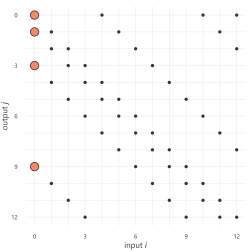
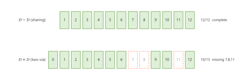
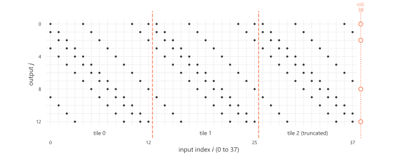
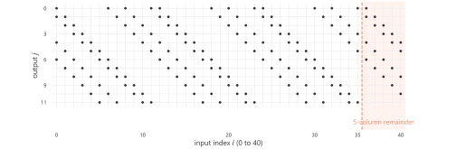
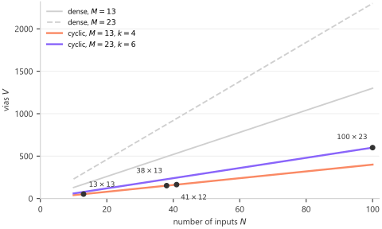
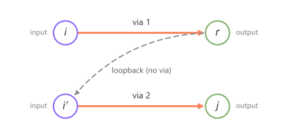

# The Problem

## The Crossbar Density Wall

:::: {.columns}
::: {.column width="55%"}
- Connect $N$ inputs to $M$ outputs on one die
- A dense crossbar places a via at **every** crossing

$$V = N \times M$$

- quadratic growth, linear usefulness
- the junction, not the wire, is the scarce resource
:::
::: {.column width="45%"}
| $N$ | $M$ | vias |
|----:|---:|-----:|
| 100 | 24 | 2,400 |
| 200 | 48 | 9,600 |
| 500 | 120 | 60,000 |
| 1,024 | 256 | 262,144 |
:::
::::

## Four Structural Penalties

- **Routing congestion** --- via arrays occupy the tracks other signals need
- **Parasitics** --- every tap loads both wires, so $RC$ grows with the tap count
- **Skew** --- input 0 and input 99 see different paths through the same block
- **No modularity** --- every $(N,M)$ pair is a fresh custom layout

. . .

> A dense crossbar cannot be designed once and stamped.

## What a Sparse Crossbar Must Deliver

1. **Uniform fan-out** --- every input has the same number of vias
2. **Few templates** --- design one column, stamp it many times
3. **Guaranteed meeting** --- any two inputs share an output
4. **Bounded routes** --- every input reaches every output
5. **Full capacity** --- a full load of signals can be routed at once
6. **Balanced loads** --- no hot rail

. . .

> We want these as *arithmetic*, not as measurement.

# A Cyclic Crossbar

## The Design Rule

Input $i$ connects to output $j$ if and only if

$$j \equiv i + d \pmod M \quad \text{for some } d \in \mathcal{D}, \qquad \mathcal{D} \subseteq \mathbb{Z}_M.$$

- $k = |\mathcal{D}|$ vias per input, by construction
- $V = kN$ vias in total, density $k/M$
- the pattern depends only on $i \bmod M$: at most $M$ column templates
- no constraint that $M$ divides $N$

## The Core at a Glance

:::: {.columns}
::: {.column width="50%"}
- $\mathcal{D} = \{0, 1, 3, 9\}$ modulo 13
- $k = 4$ vias in every column, 4 in every row
- each column is a shifted copy of one cell
- the diagonal texture is the cyclic shift
:::
::: {.column width="50%"}
{width="96%"}
:::
::::

## Costs Known Before Layout

- **Input load**: exactly $k$, by Lemma 1
- **Output load**: $L_j = \sum_{d \in \mathcal{D}} c_{j-d}$, where $c_r$ counts inputs with $i \equiv r \pmod M$
- If $M \mid N$, every output has load $kN/M$
- Pair multiplicity and route length follow from $\mathcal{D}$ alone

. . .

> No extraction, no simulation: the numbers come from the offsets.

# When Is It Routable?

## Sharing Is a Difference Condition

**Theorem.** Any two distinct inputs share an output if and only if

$$\mathcal{D} - \mathcal{D} = \mathbb{Z}_M \setminus \{0\}.$$

*Proof idea:* the outputs of input $i$ are $i + \mathcal{D}$, so the two sets meet exactly when $i - i'$ is a difference of two offsets.

- this is the cyclic-quorum condition, read as wiring
- so $k(k-1) \ge M-1$, i.e. $k \ge \left\lceil (1+\sqrt{4M-3})/2 \right\rceil$

## Covering: Differences vs Sums

{width="92%"}

- $\mathcal{D}-\mathcal{D}$ complete: every pair meets at some output
- $\mathcal{D}+\mathcal{D}$ incomplete: 3 of 13 targets need a third via

## Route Length

- a route alternates **via** (input $\to$ output) and **loopback** (output $\to$ input)
- loopback $r \mapsto r$: one wire per output, cost $c_L$ per traversal
- offsets reachable in $t$ vias are the $t$-fold sumset $t\mathcal{D}$
- $2$ vias $\iff \mathcal{D}+\mathcal{D} = \mathbb{Z}_M$; $3$ vias $\iff 3\mathcal{D} = \mathbb{Z}_M$
- three vias are guaranteed when $|\mathcal{D}+\mathcal{D}| > M-k$

| $M$ | $k_1$ (sharing) | $k_2$ (2-via) |
|----:|:---------------:|:-------------:|
| 12  | 4 | 5 |
| 13  | 4 | 5 |
| 23  | 6 | 8 |

## Capacity: A Full Load

- **capacity** $c$: any set of at most $c$ inputs reaches $c$ distinct outputs (Hall)
- for the cyclic rule: $c = \min\{|R+\mathcal{D}| : |R+\mathcal{D}| < \min(C(R),M)\}$
- $2^M$ residue sets instead of $2^N$ input sets
- $39\times13$: 10; $41\times12$: 6; $100\times23$: 9 (12 spread-optimised)
- $N = M$: capacity is $M$ automatically; it bites only when $N > M$
- exact for $M \le 30$; beyond, sample the routability instead

# The 13 × 13 Core

## The Singer Set

- $M = q^2+q+1$ with $q = 3$ gives $M = 13$
- Singer: $k = q+1 = 4$ and $\lambda = 1$
- $\mathcal{D} = \{0,1,3,9\}$
- 12 ordered differences, each nonzero residue exactly once
- $V = 52$ instead of 169: **69% fewer vias**
- every pair of inputs shares **exactly one** output

## Four Offsets Is Optimal

- three offsets give at most $3 \times 2 = 6$ differences, but 12 are needed
- so $k = 4$ is minimal for $M = 13$
- Singer meets the bound $k(k-1) \ge M-1$ with equality
- but balance is not routing: only 76.9% of pairs are within two vias
- a routing-optimal cover reaches 92.3%, at the price of $\lambda > 1$

# Scaling

## Tiling and Truncation

- tile the core $t$ times: $N = tM$, $V = tkM$ --- $39 = 3\times13$ gives **156** vias instead of 507
- truncate at column 37: $38\times13$ gives **152** instead of 494; only the last stamp is partial
- every input still has 4 vias; outputs carry 11--12

{width="80%"}

## Rectangular Targets: 41 × 12

- keep the rule, change the modulus: $\mathcal{D} = \{0,1,4,6\}$ mod 12 covers all 11 residues
- $k = 4$ is minimal; $V = 164$ instead of 492, i.e. **33.3%**
- output loads 12--15; the best of 48 covers gives 13--15
- the imbalance comes from $41 \bmod 12 = 5$, not from $\gcd(41,12)$

{width="82%"}

## Cost Grows Linearly

:::: {.columns}
::: {.column width="48%"}
- $V = kN$ against $NM$
- saving $1 - k/M$, independent of $N$
- 69% for $(13,4)$
- 67% for $(12,4)$
- 74% for $(23,6)$

. . .

> The cell does not change when the input count changes.
:::
::: {.column width="52%"}
{width="100%"}
:::
::::

## Verified Designs

```{=latex}
\begin{center}
\footnotesize
\begin{tabular}{lrrrrrr}
\hline
design & $N$ & $M$ & $k$ & $V$ & dense & out.\ load \\
\hline
$13\times13$ core      & 13  & 13 & 4 & 52  & 169  & 4 \\
$39\times13$ tiled     & 39  & 13 & 4 & 156 & 507  & 12 \\
$38\times13$ truncated & 38  & 13 & 4 & 152 & 494  & 11--12 \\
$41\times12$           & 41  & 12 & 4 & 164 & 492  & 12--15 \\
$100\times23$          & 100 & 23 & 6 & 600 & 2300 & 24--29 \\
\hline
\end{tabular}
\end{center}
```

- all counts reproduced by `interconnect/verify.py`
- in every row $V = kN$ and the density is 26--33%

# Routing

## A Route Is Two Vias

- a route alternates **via** and **loopback**; the loopback is $r \mapsto r$, one wire per output
- $2$ vias $\iff \mathcal{D}+\mathcal{D} = \mathbb{Z}_M$; $3$ vias $\iff 3\mathcal{D} = \mathbb{Z}_M$
- on the core: 30.8% direct, 46.2% two vias, 23.1% three
- the decision depends only on $j-i$: a table of $M$ entries, no BFS

{width="66%"}

## Buying Two-Via Universality

- $M = 13$, $k = 5$: $\mathcal{D} = \{0,1,2,6,9\}$
- 65 vias instead of 52, density 38.5%
- **100%** of pairs within two vias, none needs three
- $41 \times 12$ with $k = 5$: 205 vias, 41.7%, also 100%
- at full load $k=4$: 25 vias + 12 loopbacks; $k=5$: 21 + 8
- with loopback cost $c_L$: $k=5$ pays when $c_L > 2.25$ switch units

## A Cautionary Case

- a tempting formulation takes offsets modulo $N$, not modulo $M$, with $M \ll N$
- then $V = kM = 138$ rather than $kN = 600$
- 6 inputs have **no via at all**
- 2,059 of 2,300 input--output pairs are unreachable
- with offsets modulo $M$: 600 vias, 6 per input, all pairs within 3 vias

. . .

> The first question is not "how many wires" but "modulo what" 🔍

# Design Automation

## Regularity Is the Constraint

- unconstrained: $k$-regular bipartite graphs on $N+M$ vertices --- an enormous space
- cyclic ansatz: at most $\binom{M}{k}$, or $\binom{M-1}{k-1}$ up to relabelling --- independent of $N$
- 220 sets for $M = 13, k = 4$; 26,334 for $M = 23, k = 6$
- regularity is imposed *before* optimisation, not hoped for afterwards
- identical columns are interchangeable for the placer; a router-optimised block is frozen
- a pattern tuned to one router is only as good as that router

## An Objective That Cannot Work

A natural search minimises the variance of the output loads over 5,005 offset sets.

- for any $\mathcal{D}$, each output receives exactly $|\mathcal{D}|$ vias
- the load vector is $(6,\dots,6)$ for **every** candidate
- variance is zero everywhere; the strict improvement never fires
- the reported "optimal set" is simply the first combination

. . .

> An invariant objective cannot guide a search.

## Objectives That Do Vary

- **load spread** $\max_j L_j - \min_j L_j$, computed in $O(kM)$
- **two-via coverage**, by breadth-first search in $O(NM)$
- **span** $\sum_{d} d$, a proxy for the longest diagonal run

| $M$ | covers | best spread | best 2-via |
|----:|-------:|------------:|-----------:|
| 12  | 48     | 2 (13--15)  | 132/144    |
| 13  | 52     | 1 (11--12)  | 156/169    |
| 23  | 8,602  | 2 (25--27)  | 506/529    |

For $M = 23$, one set achieves both: $\{0,1,3,8,12,18\}$.

## Relaxing the Guarantee

The cover is what buys sharing --- not capacity, not routing. Lower $k$:

| $k$ | switches | capacity | routable at 23 |
|----:|---------:|---------:|--------------:|
| 2 | 200 | 2 | 0.0% |
| 3 | 300 | 3 | 27.8% |
| 4 | 400 | 4 | 82.2% |
| 5 | 500 | 8 | 96.4% |
| 6 | 600 | 12 | 98.9% |

- graceful to $k = 5$, sharp below
- at $k_{\min}$ the cover is free: the gap is $\sqrt{M}$, not the cover
- partial covers are worse: one element dropped leaves 8 of 22 residues uncovered

# Implications and Conclusions

## What It Buys in Layout

- at most $M$ column templates, characterised once and stamped
- identical load per input: a known, uniform driver load
- sparse via sites, so the router sees a pattern rather than a maze
- routes enumerated at design time; runtime is a table read

## What the Saving Buys

- Elmore ratio $(1+\beta L_{\rm cyc})/(1+\beta L_{\rm dense})$, $\beta$ = tap vs wire delay
- switches 0.31 / 0.33 / 0.26 for $13\times13$ / $41\times12$ / $100\times23$
- capacitance 0.73 / 0.55 / 0.38; delay 0.67 / 0.51 / 0.35 at $W = 100\,\mu$m
- but at $W = 400\,\mu$m the core's delay ratio is 0.87
- switch-area first, delay second: the rails stay

## Against Router-Optimised Fabrics

| 168 inputs | sw/input | population | routable at 24 |
|:-----------|---------:|-----------:|--------------:|
| FLEX8000 baseline (reported) | 2 | 336 | $<1\%$ |
| annealed $168\times29$ (reported) | 2.8 | 464 | $>96\%$ |
| cyclic $168\times24$, $k=6$ | 6 | 1,008 | 98.7% |
| cyclic $168\times29$, $k=6$ | 6 | 1,008 | 100% |

- twice the population, but **every pair shares an output**
- capacity exact, not sampled

## Limits of the Model

- counts switches and taps: no wire length, crosstalk, driver sizing
- loopback not free: $c_L$ per traversal (wire + buffer + mux)
- rails remain --- sparsity removes taps, not the rails
- numbers are analytic, not extracted from a placed design

## Conclusions

- a cyclic crossbar is $k$-regular with at most $M$ templates and cost $kN$
- **sharing** $\iff \mathcal{D}-\mathcal{D}$ is complete
- **2 vias** $\iff \mathcal{D}+\mathcal{D}$ is complete; **3 vias** when $|\mathcal{D}+\mathcal{D}| > M-k$
- capacity is exact from $2^M$ residue sets: 10, 6, 9 at $39\times13$, $41\times12$, $100\times23$
- Singer $(13,4,1)$: 52 vias, $\lambda = 1$; relaxation trades $k$ for capacity
- the switch saving is not a delay saving: 0.31 vs 0.67 at $100\,\mu$m
- the route plan is $M$ entries; regularity is what makes the design searchable

## Thank You

:::: {.columns}
::: {.column width="52%"}
```{=latex}
\begin{center}
{\Large\bfseries Questions?} \;🙏\\[1.2em]
{\footnotesize
paper: \texttt{paper/interconnect.pdf}\\[0.3em]
verification: \texttt{interconnect/verify.py}\\[0.3em]
figures: \texttt{paper/fig-iq-*.svg}}
\end{center}
```
:::
::: {.column width="48%"}
{width="100%"}
:::
::::
