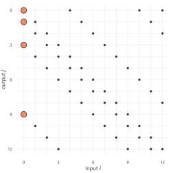
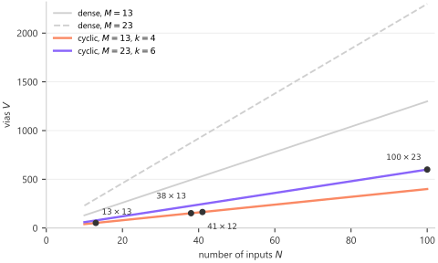
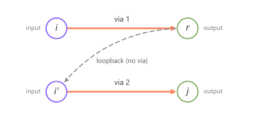

---
title: Designing Highly Routable Interconnection Networks with Cyclic Quorum Systems
author: Wai-Shing Luk
documentclass: IEEEtran
csl: ieee.csl
bibliography:
  - cyclic_quorum.bib
keywords: interconnection networks, crossbar, cyclic quorum systems, difference sets, projective planes, routing, physical design
abstract: |
  A dense crossbar connecting $N$ inputs to $M$ outputs needs $N M$ switch points, whose area and tap capacitance limit it at advanced nodes. We study a sparse alternative generated cyclically from an offset set $\mathcal{D}$: input $i$ connects to output $(i+d) \bmod M$ for each $d \in \mathcal{D}$. The result is $k$-regular with $k = |\mathcal{D}|$ switches per input and at most $M$ column templates: a stamped macro cell, not a custom grid.

  We give exact conditions. Two inputs share an output if and only if $\mathcal{D}$ is a difference cover modulo $M$ ($\mathcal{D}-\mathcal{D} = \mathbb{Z}_M \setminus \{0\}$), which forces $k(k-1) \ge M-1$ and is attained by a Singer difference set. With a one-to-one loopback the offsets reachable in $t$ switches form the $t$-fold sumset, so two switches suffice for all pairs exactly when $\mathcal{D}+\mathcal{D} = \mathbb{Z}_M$, and three suffice when the threefold sumset is complete, for which $|\mathcal{D}+\mathcal{D}| > M-k$ is a checkable sufficient condition. The $13\times13$ Singer core uses 52 switches instead of 169, with one shared output per pair; tiling, truncation and a rectangular variant hold 26--33\% density with linear cost, and their concentrator capacity is exactly computable from $2^M$ residue sets.

  Two formulation pitfalls are documented, an Elmore model shows that switch savings translate only partly into delay and energy, and a comparison with router-optimised crossbars makes the trade explicit.
...

## Introduction

Interconnect is now a first-order constraint on silicon design. A crossbar that connects $N$ inputs to $M$ outputs places a switchable junction at every crossing, so it needs $N M$ vias: 2,400 for a 100-to-24 crossbar, 9,600 for 200-to-48, 60,000 for 500-to-120, and 262,144 for 1,024-to-256. Each junction costs area and mask complexity, loads both wires with capacitance, and occupies routing tracks around the crossing. The consequences are the familiar ones: local metal congestion that starves neighbouring signals of tracks, $RC$ delay that grows with the number of taps on a rail, and skew between inputs whose paths have different lengths.

A less discussed cost is the loss of modularity. A dense crossbar is a single custom block: its via array changes with every $(N, M)$ pair, so it cannot be designed once and stamped across a floorplan. Designs that must hit an exact input count at the last minute are therefore re-laid out rather than re-parameterised.

This paper takes the opposite route. It keeps the crossbar topology and the regular grid of vertical input rails and horizontal output rails, but deletes most junctions according to a cyclic rule: a small offset set $\mathcal{D}$ is chosen, and input $i$ is connected to output $(i+d) \bmod M$ for each $d \in \mathcal{D}$. The rule has three consequences that a random or hand-drawn sparsification does not. First, every input has exactly $k = |\mathcal{D}|$ vias, so the fan-out is uniform by construction. Second, the via pattern depends only on $i \bmod M$, so the layout contains at most $M$ distinct column templates, each repeated as often as the floorplan requires. Third, and most importantly, the connectivity of the resulting bipartite graph is decided by a purely arithmetic condition on the pairwise differences of $\mathcal{D}$, so routability can be designed rather than measured.

The model studied here is deliberately abstract: an $n \times m$ array of switch points, with $n \ge m$, that connects a set of sources to a smaller set of sinks. This is the classical sparse-crossbar model of programmable logic, where the array is the local interconnect that lets a cluster of logic elements choose its inputs from the cluster wires [@lemieux2004design]. Its two cost measures are the *population* (the number of switch points) and the *capacity* (how many signals can be guaranteed to route at once); a full crossbar has population $nm$ and capacity $m$, and the question is how far the population can fall before capacity and routability suffer [@lemieux2000]. Lemieux, Leventis and Lewis answer it constructively, by spreading the switch points so that every subset of inputs reaches as many outputs as possible, in the sense of Hall's theorem, and by evaluating the result as the fraction of random connection requests that a flow router can complete. Section 4 returns to that framework: for the cyclic construction both the evaluation and the construction heuristic become exact arithmetic.

The construction is the incidence structure of a *cyclic quorum system*, the object used in distributed mutual exclusion to guarantee that any two operations meet at a common site [@luk1997two; @maekawa1985]. In that setting one wants a base quorum of size $k$ whose cyclic shifts are pairwise intersecting, which is exactly the difference-cover condition studied here; in this paper the same condition is read as a statement about vias and routes. The most efficient base quorums come from finite projective planes, and the order-3 plane yields the set $\{0,1,3,9\}$ modulo 13 used throughout as the running example [@singer1938; @hall1986combinatorial].

The paper makes six contributions.

1. A precise model of a cyclic crossbar as a $k$-regular bipartite graph $\mathcal{C}(N,M,\mathcal{D})$, with cost measures that separate via count, load balance, template count and route length (Section 3).
2. Two exact structural theorems: pairwise input sharing holds if and only if $\mathcal{D}-\mathcal{D}$ covers every nonzero residue, and every pair is reachable in $t$ vias if and only if the $t$-fold sumset of $\mathcal{D}$ is complete (Section 4). The theorems yield the lower bounds $k(k-1) \ge M-1$ and $k(k+1)/2 \ge M$, they turn routability into an arithmetic check rather than a router measurement, and they make the Hall capacity computable over $2^M$ residue sets instead of $2^N$ input sets.
3. A concrete family of designs---the $13 \times 13$ projective-plane core, its 39-column tiling, its 38-column truncation, and a rectangular $41 \times 12$ variant---with verified via counts, loads, pair multiplicities and hop distributions (Sections 5 and 6, Table II).
4. A routing analysis that separates the two costs, explains when two vias are enough, and repairs a natural but incorrect generalisation in which offsets are taken modulo $N$ (Section 7).
5. A design-automation analysis (Section 8): the load-variance objective used by the accompanying search script is *invariant* under the choice of offsets, so its enumeration is vacuous; we prove this, give two objectives that do vary, and report exhaustive results for $M = 12, 13, 23$.
6. A parameterised electrical and loopback model that separates switch savings from delay and energy savings, and a comparison with router-optimised sparse crossbars at their own dimensions (Section 9).

All counts were produced by the reference scripts and are reproduced by `interconnect/verify.py` (Appendix A).

## Related Work

Quorum systems coordinate distributed processes without global knowledge or central control. Maekawa's algorithm was among the first to pursue symmetry, that is, equal work and equal responsibility, with a minimal quorum size, and it established the connection between optimal quorums and finite projective planes [@maekawa1985]. Saxena and Rai survey the permission-based mutual-exclusion algorithms built on quorums [@saxena2003survey]. Luk and Wong proposed cyclic difference sets as the basis of quorum systems for arbitrary $N$, with a quorum size close to the lower bound $\sqrt{N}$ [@luk1997two]; the construction studied here is the same cyclic scheme, viewed as a wiring pattern.

Cyclic quorums have since been applied to distributed all-pairs computation [@kleinheksel2016scaling; @kleinheksel2018efficient; @bian2021efficient], to heterogeneous wakeup scheduling in wireless sensor networks [@lai2010heterogenous; @jiang2005quorum], and to sequence parallelism for attention [@bian2025cqs]. In all of these the base quorum is the object being optimised; here the base quorum is instead the object that is *fabricated*, and the optimisation targets are area, load balance and route length.

On the combinatorial side, difference sets and difference covers are classical [@hall1986combinatorial; @colbourn2006handbook]. Singer's theorem supplies perfect difference sets for every prime power $q$, with parameters $(q^2+q+1,\, q+1,\, 1)$ [@singer1938]; Bose gave an independent construction of the associated block designs [@bose1939]. Difference covers also underlie linear-time suffix-array construction, where the DC3 algorithm samples positions by residue modulo 3 and relies on the cover property to compare suffixes efficiently [@karkkainen2006linear].

On the interconnect side, crossbars, multistage networks and their cost models are treated by Beneš and by Dally and Towles [@benes1965mathematical; @dally2004principles]. Sparse crossbars are of course not new; the contribution here is not sparsity as such but the arithmetic that makes sparsity *uniform*: a single offset set fixes the fan-out of every input, the number of distinct column templates, the exact intersection multiplicity of every input pair, and the worst-case route length.

The local interconnect of a logic cluster is one instance of this model: an $n \times m$ sparse crossbar whose inputs are the cluster wires and whose outputs feed the logic elements. Lemieux, Leventis and Lewis define its population and capacity, observe that capacity is exponential to compute over subsets of inputs, and instead evaluate routability as the fraction of random test vectors that a network-flow router completes; their construction spreads the switch points to maximise the neighbour set of every input subset, which they approximate by maximising the pairwise Hamming distance between input patterns [@lemieux2000]. The cyclic construction studied here can be read as an exact version of that programme. The input patterns are cyclic shifts of one pattern, so the Hamming distance between inputs $i$ and $i'$ is $2(k-\lambda(i-i'))$; a Singer set makes it constant and maximal, the neighbour sets are translates of a difference cover, and capacity is computable over $2^M$ residue sets rather than $2^N$ input sets. What is bought is exactness and regularity; what is paid is switch count, since a router-optimised pattern uses fewer switches for the same sampled routability (Section 4).

## Network Model and Cost Measures

### Dense crossbar

Let $I = \{0, \dots, N-1\}$ be the inputs, drawn as vertical rails, and $O = \{0, \dots, M-1\}$ the outputs, drawn as horizontal rails. A *via* at $(i,j)$ connects input $i$ to output $j$. A dense crossbar has a via at every pair, so $V = NM$. Its cost grows quadratically in the problem size while its useful work grows linearly, which is the density wall: doubling both dimensions quadruples the junction count.

### Cyclic crossbar

**Definition 1 (Cyclic crossbar).** Given $N$, $M$ and a set $\mathcal{D} \subseteq \mathbb{Z}_M$ of *row offsets*, the cyclic crossbar $\mathcal{C}(N,M,\mathcal{D})$ has a via at $(i,j)$ if and only if
$$j \equiv i + d \pmod M \quad \text{for some } d \in \mathcal{D}.$$

We write $k = |\mathcal{D}|$. The design is translation-invariant in the input index: shifting the input index by one shifts every via down by one row and wraps around. Nothing forces $N$ to be a multiple of $M$, which is what makes the construction usable for awkward specifications.

We call a populated crossing a *via*, following silicon-crossbar usage; in a field-programmable device the same object is a programmable switch, and in the PLD literature it is a crosspoint (Section 2). The two names denote one thing: a connection that is present or absent.

The same object can be read as a bipartite graph $G = (I \cup O, E)$ with $E$ the set of vias, or as an $N \times M$ 0--1 matrix $A$ with $A_{ij} = 1$ exactly at the vias. The matrix is a *circulant-like* band: row $i$ of $A$ is row $i+1$ shifted by one position, and the matrix is periodic in $i$ with period $M$.

### Cost measures

Six quantities decide whether a design is usable.

- **Via count** $V = \sum_{i,j} A_{ij}$ (the *population* in the terminology of [@lemieux2000]), and the **density** $\rho = V/(NM)$.
- **Input load** (vias per input) and **output load** (vias per output rail). The output load is the number of taps on a horizontal rail, hence the capacitive load that the driving input must charge. For the cyclic rule the output load is uniform exactly when $M \mid N$; otherwise the residues divide into classes of size $q$ and $q+1$, and Lemma 2 leaves a spread that no choice of $\mathcal{D}$ removes entirely.
- **Intersection multiplicity**: for inputs $i \ne i'$, the number $|O_i \cap O_{i'}|$ of outputs they share, where $O_i$ is the output set of input $i$. Multiplicity at least one is what makes the network routable; multiplicity much larger than one means contention when many inputs arbitrate for the same output.
- **Capacity** $c$: the largest number such that every subset of at most $c$ inputs can be connected simultaneously to distinct outputs, i.e., the crossbar is an $(N,M,c)$-concentrator. This is the quantity that decides whether the fabric can carry a full load of signals, and it is analysed in Section 4.
- **Route length**, in vias, between an input and an output. We count vias only, treating the loopback fabric of Section 7 as free; a route that uses two vias is a two-hop route in the usual sense.
- **Template count**: the number of distinct column patterns, which bounds the number of layout cells that must be designed.

## When Is a Cyclic Crossbar Routable?

### Sharing, loads and reachability

The next three results reduce the electrical questions to arithmetic on $\mathcal{D}$. They are elementary, but they are what makes the design space searchable.

**Lemma 1 (Regularity and templates).** In $\mathcal{C}(N,M,\mathcal{D})$ every input has exactly $k$ vias and every column pattern depends only on $i \bmod M$. Consequently there are at most $M$ distinct column templates, and template $r$ occurs $\lceil N/M \rceil$ or $\lfloor N/M \rfloor$ times.

*Proof.* For fixed $i$, the map $d \mapsto (i+d) \bmod M$ is injective on $\mathbb{Z}_M$, so exactly $k$ distinct outputs are reached. The pattern is a function of $i \bmod M$ because the rule is. $\square$

**Lemma 2 (Output loads).** Let $c_r = |\{i < N : i \equiv r \pmod M\}|$ for $r \in \mathbb{Z}_M$. Then the load of output $j$ is
$$L_j = \sum_{d \in \mathcal{D}} c_{j-d}.$$
In particular, if $M$ divides $N$ then every output has load $kN/M$.

*Proof.* Output $j$ receives a via from input $i$ exactly when $i \equiv j-d$ for some $d \in \mathcal{D}$; summing over $d$ counts each contributing residue class once. When $M \mid N$ all $c_r$ equal $N/M$. $\square$

Lemma 2 explains every load number in this paper: when $N = qM + s$, the residues $0, \dots, s-1$ occur $q+1$ times and the rest $q$ times, so the output loads lie between $qk$ and $(q+1)k$, and the actual spread depends on how the $s$ "heavy" residues align with $-\mathcal{D}$.

**Definition 2 (Covers).** A set $\mathcal{D} \subseteq \mathbb{Z}_M$ is a *difference cover* if every nonzero residue is a difference of two elements of $\mathcal{D}$, that is, $\mathcal{D} - \mathcal{D} = \mathbb{Z}_M \setminus \{0\}$. It is a *sum cover* if $\mathcal{D} + \mathcal{D} = \mathbb{Z}_M$.

**Theorem 1 (Pairwise sharing).** In $\mathcal{C}(N,M,\mathcal{D})$, any two distinct inputs share at least one output if and only if $\mathcal{D}$ is a difference cover modulo $M$. If, in addition, every nonzero residue occurs exactly $\lambda$ times among the ordered differences, then every pair of inputs shares exactly $\lambda$ outputs.

*Proof.* The output set of input $i$ is $i + \mathcal{D} \pmod M$. For $i \ne i'$,
$$(i+\mathcal{D}) \cap (i'+\mathcal{D}) \ne \emptyset \iff i - i' \equiv d' - d \pmod M$$
for some $d, d' \in \mathcal{D}$, that is, if and only if $i-i' \in \mathcal{D}-\mathcal{D}$. As $i-i'$ ranges over all nonzero residues, the condition is $\mathcal{D}-\mathcal{D} = \mathbb{Z}_M \setminus \{0\}$. The number of common outputs is exactly the number of representations of $i-i'$ as $d'-d$, which is $\lambda$ when the difference multiplicities are constant. $\square$

**Corollary 1 (Lower bound and its attainment).** A cyclic crossbar on $M$ outputs in which every input pair shares an output requires $k(k-1) \ge M-1$, that is,
$$k \;\ge\; \left\lceil \frac{1+\sqrt{4M-3}}{2} \right\rceil.$$
When $M = q^2+q+1$ for a prime power $q$, the Singer difference set with $k = q+1$ and $\lambda = 1$ attains the bound.

*Proof.* There are only $k(k-1)$ ordered differences of $k$ elements, and they must cover $M-1$ nonzero residues. Singer's theorem gives $(q^2+q+1, q+1, 1)$ difference sets [@singer1938]. $\square$

For $M = 13$ the bound gives $k \ge 4$ because $3 \cdot 2 = 6 < 12 \le 12 = 4 \cdot 3$; for $M = 12$ it also gives $k \ge 4$; for $M = 23$ it gives $k \ge 6$ because $5 \cdot 4 = 20 < 22 \le 30 = 6 \cdot 5$. These are the three moduli used in the rest of the paper.

The bound is necessary but not sufficient. Modulo 20 it allows $k = 5$ ($5\cdot4 = 20 \ge 19$), yet an exhaustive check finds no 5-element difference cover, so the true minimum there is 6; this is the smallest modulus where the counting bound is unattainable. The sum-cover bound $k(k+1)/2 \ge M$ is looser still: exhaustive enumeration for $M \le 23$ shows that the smallest sum cover is one element larger than the bound at $M = 6, 18, 20, 21, 22$ and $23$. Both bounds are therefore design guidelines, not guarantees, and the tables in this paper are computed rather than derived from them.

Pairwise sharing guarantees that two inputs can always *meet* at an output, which is what arbitration and broadcast need. Unicast routing from an input to an output is a different question, because a path must alternate between the via fabric and a loopback fabric that returns an output to an input. We model the loopback as a fixed injection $\lambda : O \to I$ with $\lambda(j) = j$ for $j < M$; this is available whenever $M \le N$ and costs one wire per output. A route with $t$ vias uses $t-1$ loopback traversals, so we assign it the weighted cost
$$\kappa(\text{route}) \;=\; t + c_L\,(t-1),$$
where $c_L \ge 0$ is the cost of one loopback traversal in switch equivalents; $c_L = 0$ recovers the pure via count used in Table II. Since $\kappa$ is increasing in $t$, the minimum-via route is also the minimum-cost route for every $c_L$, so Theorem 2 characterises optimal routes for all loopback costs and the choice of $c_L$ only changes which design is worth building (Section 9).

**Theorem 2 (Reachability).** Assume the identity loopback, $M \le N$, and $0 \in \mathcal{D}$. A pair $(i,j)$ is reachable with at most $t$ vias if and only if $j-i$ lies in the $t$-fold sumset $t\mathcal{D} = \mathcal{D} + \cdots + \mathcal{D}$ ($t$ terms). Consequently:

1. every pair is reachable with at most two vias if and only if $\mathcal{D}+\mathcal{D} = \mathbb{Z}_M$;
2. every pair is reachable with at most three vias if and only if $3\mathcal{D} = \mathbb{Z}_M$.

*Proof.* A route with $t$ vias visits rows $r_1, \dots, r_t$ with $r_1 \in i+\mathcal{D}$ and $r_{s+1} \in r_s+\mathcal{D}$ (the loopback is free), and ends at $j = r_t + d$ with $d \in \mathcal{D}$; hence $j-i \in t\mathcal{D}$. Conversely any representation $j-i = d_1+\cdots+d_t$ gives the route $r_1 = i+d_1$, $r_2 = r_1+d_2$, \dots, $r_t = r_{t-1}+d_t = j$. Since $0 \in \mathcal{D}$, the sumsets are nested, so "at most $t$" and "exactly $t$" coincide. $\square$

**Proposition 1 (Sufficient condition for three vias).** If $|\mathcal{D}+\mathcal{D}| > M-k$, then $3\mathcal{D} = \mathbb{Z}_M$. More generally, $(t+1)\mathcal{D} = \mathbb{Z}_M$ whenever $|t\mathcal{D}| > M-k$.

*Proof.* Fix $z \in \mathbb{Z}_M$. The set $z-\mathcal{D}$ has $k$ elements; since $|\mathcal{D}+\mathcal{D}| + k > M$, it meets $\mathcal{D}+\mathcal{D}$, say $z-d = a+b$ with $d,a,b \in \mathcal{D}$. Then $z = a+b+d \in 3\mathcal{D}$. The same argument with $t\mathcal{D}$ in place of $\mathcal{D}+\mathcal{D}$ gives the general form. $\square$

**Remark 1 (Where the condition bites).** The condition settles the designs of this paper by proof rather than by enumeration: $|\mathcal{D}+\mathcal{D}| = 10 > 9$ for the $13 \times 13$ core, $9 > 8$ for $41 \times 12$, and $18 > 17$ for the spread-optimised $100 \times 23$ set. The shipped $\{0,1,2,3,7,11\}$ sits exactly at $|\mathcal{D}+\mathcal{D}| = M-k = 17$ and is confirmed by enumeration instead. Exhaustive enumeration also locates the boundary: every minimum-size cover with $M \le 31$, and every cover one size larger for $M \le 28$, satisfies $3\mathcal{D} = \mathbb{Z}_M$ except at $M = 24$ and $M = 28$; both counterexamples sit exactly at $|\mathcal{D}+\mathcal{D}| = M-k$, where the counting argument is tight. The first is $\mathcal{D} = \{0,1,3,7,13,15,19\}$ modulo 24, whose threefold sumset omits 12, so 24 of its 576 pairs need four vias; at $M = 28$ the set $\{0,1,3,4,8,14,17\}$ omits 27. For the three moduli used here every cover qualifies---48, 52 and 8,602 sets---so the condition is a one-line test over $M$ residues, not an assumption about covers in general.

**Corollary 2.** Universal two-via routing requires $k(k+1)/2 \ge M$, since $\mathcal{D}+\mathcal{D}$ has at most $k(k+1)/2$ distinct elements.

The two thresholds are genuinely different. For $M = 13$, $k = 4$ gives sharing but not two-via universality ($|\mathcal{D}+\mathcal{D}| \le 10 < 13$); $k = 5$ admits a sum cover such as $\{0,1,2,6,9\}$, at the price of 65 vias instead of 52. Three vias need only $|3\mathcal{D}| = M$, which the Singer set already attains. Table I lists the smallest covers found by exhaustive search for the three moduli.

```{=latex}
\begin{table*}[t]
\centering
\caption{Covering conditions for the three moduli used in this paper. $k_1$ is the smallest size of a difference cover, $k_2$ the smallest size of a sum cover; both were found by exhaustive enumeration. The profile counts how many nonzero residues occur once, twice and three times as ordered differences.}
\label{tab:covers}
\begin{tabular}{cccccl}
\hline
$M$ & $k_1$ & difference cover & profile & $k_2$ & sum cover \\
\hline
12 & 4 & $\{0,1,4,6\}$ & $10\times1,\ 1\times2$ & 5 & $\{0,1,3,5,6\}$ \\
13 & 4 & $\{0,1,3,9\}$ & $12\times1$ & 5 & $\{0,1,2,6,9\}$ \\
23 & 6 & $\{0,1,2,3,7,11\}$ & $16\times1,\ 4\times2,\ 2\times3$ & 8 & $\{0,1,2,3,4,5,11,16\}$ \\
\hline
\end{tabular}
\end{table*}
```

The multiplicity $\lambda$ has a physical meaning. With $\lambda = 1$ every pair of inputs contends for at most one common output, so the arbitration graph is a matching and the network behaves like a projective plane; with $\lambda > 1$ some pairs have several candidate rendezvous points, which can be used for load spreading but also creates correlated contention. Tiling (Section 6.1) drives $\lambda$ up to the tile count for inputs in the same residue class, which is the price of reusing one macro cell. The same quantity has a coding reading: row $i$ of the matrix is a 0--1 vector of weight $k$, and its Hamming distance to row $i'$ is $2(k-\lambda(i-i'))$. A Singer set therefore gives every pair the same, maximal separation---which is exactly the property that the switch-spreading heuristic of Lemieux et al. aims at [@lemieux2000].

### Capacity and simultaneous connections

Reachability concerns one connection at a time; a crossbar is used with many at once. Following the terminology of Section 3, the *capacity* of an $(N,M)$ crossbar is the largest $c$ such that every subset of at most $c$ inputs can be connected simultaneously to $c$ distinct outputs---that is, the crossbar is an $(N,M,c)$-concentrator. By Hall's theorem this holds if and only if $|N(S)| \ge |S|$ for every $S \subseteq I$.

Like the test-vector model of [@lemieux2000], capacity treats a request as an unlabelled set: the question is whether $c$ signals can be placed on $c$ distinct outputs, not whether a particular signal reaches a particular output. This is the right model when the sparse crossbar is a concentrator followed by a permutation stage, as in a logic cluster where a sparse crossbar selects which cluster wires enter and a local crossbar assigns them to individual inputs. Without such a stage the requirement is a specified matching, a strictly stronger property; the reachability of Section 4-A is its single-signal case. We keep the concentrator model throughout, because it is the one for which capacity and test-vector routability are defined, and because it is the model under which the sparse fabrics of [@lemieux2000] are used.

For a cyclic crossbar the condition collapses to residues. If $R = \{i \bmod M : i \in S\}$ then $N(S) = R + \mathcal{D}$, and the largest $S$ with residue set $R$ has $\min(C(R), M)$ elements, where $C(R) = \sum_{r \in R} c_r$. Hence
$$c \;=\; \min\{\, |R+\mathcal{D}| \;:\; R \subseteq \mathbb{Z}_M,\ |R+\mathcal{D}| < \min(C(R), M) \,\},$$
with $c = M$ if the set is empty. The search is over $2^M$ residue sets rather than $2^N$ input sets---the exponential that Lemieux et al. report as a practical obstacle becomes harmless at these dimensions: for the $13 \times 13$ core the check examines 8,192 subsets.

Two bounds are immediate: $k \le c \le M$. The lower bound holds because $N(S) \supseteq N(i)$ for any $i \in S$, so Hall's condition is automatic for $|S| \le k$; the upper bound is the number of outputs. Multi-hop routing cannot raise the upper bound, because each additional via occupies another output, so capacity is inherently a single-hop notion.

For $M$ beyond about 30 the $2^M$ enumeration becomes impractical, and four things change. The capacity can be bounded rather than computed ($k \le c \le M$), and a branch-and-bound that prunes on $|R+\mathcal{D}|$ is far faster than exhaustive enumeration in practice. The offset set itself comes from a backtracking search rather than from enumeration, since covers are rare even when $\binom{M}{k}$ is large. And the density $k/M \approx 1/\sqrt{M}$ falls with $M$, so large moduli are the favourable regime for area; the routing table stays linear at $M$ entries while the checks move from exhaustive to sampled. The three-via guarantee weakens as well: the counting condition $|2\mathcal{D}| > M-k$ cannot hold once $M > k(k+1)/2 + k$, so beyond that either $k$ grows or a fourth hop is accepted. Beyond a few hundred outputs, clustering into blocks of about 31 outputs and composing the blocks is the natural scaling path. Section 8-D quantifies the alternative: when the sharing condition is relaxed, $k$ can be lowered at a measured cost in capacity and sampled routability.

Evaluating the formula gives 13 for the $13 \times 13$ core, 10 for its 39- and 38-input versions, 6 for $41 \times 12$, and 9 for the $100 \times 23$ design (12 with the spread-optimised offset set). The value 6 for $41 \times 12$ has a seven-input witness: four inputs of residue 4 and three of residue 5 see only the six outputs $\{0,1,2,5,6,7\}$, because $\{0,1\}+\mathcal{D} = \{0,1,2,5,6,7\}$ modulo 12.

One fact organises these numbers. When $N = M$ the capacity is $M$ for *any* offset set containing 0, because input $i$ reaches output $i$; capacity is therefore informative only when $N > M$, which is the regime of [@lemieux2000]. There the cost appears: inputs with the same residue modulo $M$ have identical output sets, so they compete for the same $k$ outputs, and the guaranteed capacity falls to 10, 6 and 9. Tiling and truncation buy input count with capacity, and $41 \times 12$ is the extreme case at half capacity.

The worst case is also pessimistic. Over 20,000 random full-load vectors, the fraction that a maximum matching routes is 100\% for the core, 96.8\% for the tiled design, 96.2\% for $41 \times 12$ and 99.1\% for $100 \times 23$, with a standard error below 0.2 percentage points. Raising $k$ to 5 for the rectangular design doubles its capacity from 6 to 9 and lifts sampled routability to 99.5\%, at 205 vias instead of 164. This reproduces the observation that capacity is a conservative guarantee while random vectors are usually routable [@lemieux2000], and it means the cyclic designs meet the 95\% routability point used there while remaining exactly regular. The price is switch count: at their dimensions a router-optimised pattern uses about two to three switches per input, whereas pairwise sharing forces $k \ge 6$ for $M = 24$. The comparison should therefore be read as switches traded for certainty and regularity, not as an area win.

## The Projective-Plane Core

The order-3 projective plane suggests the smallest interesting core. Singer's construction gives a $(13,4,1)$ difference set; with the multiplier normalised so that the set contains 0, one representative is
$$\mathcal{D} = \{0, 1, 3, 9\} \pmod{13}.$$
Its twelve ordered differences are

```{=latex}
\begin{center}
\begin{tabular}{cccc}
$1-0=1$ & $3-0=3$ & $9-0=9$ & $0-1=12$ \\
$3-1=2$ & $9-1=8$ & $0-3=10$ & $1-3=11$ \\
$9-3=6$ & $0-9=4$ & $1-9=5$ & $3-9=7$ \\
\end{tabular}
\end{center}
```

Every nonzero residue modulo 13 appears exactly once. Hence, by Theorem 1, every pair of the 78 input pairs shares exactly one output, and by Lemma 2 every output rail carries exactly four vias. The core therefore has

$$V = 13 \times 4 = 52 \text{ vias}, \qquad \rho = \frac{52}{169} = 30.8\%,$$

a 69.2\% reduction against the dense $13 \times 13$ array at identical input and output counts. The design is optimal in the sense of Corollary 1: no $k = 3$ cover exists, because three elements produce only six ordered differences and twelve are needed.

{width="62%"}

Figure 1 shows the resulting matrix. Because the pattern is a shifted copy of one column, the layout is a single 13-column macro cell repeated; the diagonal texture is a consequence of the cyclic shift, not an artefact of the drawing.

Routing with the identity loopback is already efficient: 52 of the 169 input--output pairs (30.8\%) are direct, 78 (46.2\%) need two vias, and 39 (23.1\%) need three; no pair needs more, consistent with $3\mathcal{D} = \mathbb{Z}_{13}$. Two-via coverage is not universal because $|\mathcal{D}+\mathcal{D}| = 10 < 13$.

It is worth noting that the Singer set is optimal for *balance*, not for *routing effort*. Among the 52 difference covers modulo 13, the best two-via coverage is 156 of 169 pairs (92.3\%), attained for example by $\{1,3,10,11\}$, but that set has difference multiplicities above one and therefore correlated contention. The design therefore exposes a trade-off that a pure via count hides: $\lambda = 1$ buys predictable arbitration, while a skewed difference multiset buys shorter routes.

## Scaling to Arbitrary Dimensions

The core fixes $M = 13$. Two operations extend it without redesigning the cell: tiling, which increases $N$ in multiples of $M$, and truncation, which removes columns from the last tile.

### Horizontal tiling

Let $N = tM$ and keep the rule $j \equiv i + d \pmod M$. By Lemma 1 each input still has $k$ vias, so $V = tkM$; by Lemma 2 each output rail now carries $tk$ vias. For $t = 3$ and $M = 13$ the design is $39 \times 13$ with $V = 156$ against 507 dense (30.8\%), and every output carries 12 vias.

Pairwise sharing survives tiling, because the condition of Theorem 1 depends only on $i - i' \bmod M$. What changes is the multiplicity: inputs whose indices are congruent modulo 13 have identical output sets and therefore share all four outputs, while inputs from different residue classes share exactly one. The measured distribution over all 741 input pairs is 702 pairs sharing one output and 39 pairs sharing four.

### Truncation

An arbitrary input count is obtained by generating $\lceil N/M \rceil$ tiles and keeping only the first $N$ columns. For $N = 38$ the design is $38 \times 13$ with $V = 152$ against 494 dense (30.8\%); each input still has four vias, and the output loads are 11 or 12 rather than 12, because the one residue class that lost a column now feeds one via fewer into each of the four rows it reaches. No property is lost: Theorem 1 does not depend on $N$, and removing a column can only remove shared outputs, never the last one for a pair, since the pair condition is evaluated on $\mathcal{D}$ alone.

There is a limit, however. Row $j$ is fed only by inputs $i \equiv j-d \pmod M$ for $d \in \mathcal{D}$; when fewer than $M$ columns remain, some of those indices exceed $N-1$ and are simply absent, so a row can be left with no via at all. Keeping $N \ge M$ guarantees every row at least one via, since $(j-d) \bmod M < M \le N$, and then the spread of the row loads is at most $k$ by Lemma 2. Truncation below $M$ columns is therefore safe for arbitration --- every pair of remaining inputs still shares an output --- but not for routing, because some destinations cease to exist.

The practical value of truncation is that the *cell* is unchanged. Only the number of stamped copies changes, and the last copy is partially populated; columns 0--37 keep the same electrical and crosstalk environment as the untruncated design, which is what makes the macro approach viable.

```{=latex}
\begin{figure*}[t]
\centering
\includegraphics[width=0.90\linewidth]{fig-iq-scale.pdf}
\caption{Tiling and truncation of the core. Three 13-column tiles give 39 inputs; truncating at column 37 gives the 38-input target. Dashed lines mark cell boundaries; the open circles at column 38 are the vias that truncation removes, and apart from that column the last tile is fully populated.}
\label{fig:scale}
\end{figure*}
```

### Rectangular targets

When the output count is not 13, the rule is unchanged but the modulus changes. For the $41 \times 12$ specification, take $M = 12$ and
$$\mathcal{D} = \{0, 1, 4, 6\} \pmod{12}.$$
This is a difference cover: all eleven nonzero residues appear, ten once and the residue 6 twice (Table I). By Corollary 1, $k = 4$ is minimal because three elements give only six differences. The design has $41 \times 4 = 164$ vias against 492 dense, a density of 33.3\%, and every input still has four vias, so the driver load is uniform.

```{=latex}
\begin{figure*}[t]
\centering
\includegraphics[width=0.90\linewidth]{fig-iq-wave.pdf}
\caption{The $41 \times 12$ design. The offset set $\{0,1,4,6\}$ modulo 12 produces a diagonal wave that repeats every 12 columns; the dashed line marks the end of the last complete period, and the shaded five-column remainder of $41 = 3 \cdot 12 + 5$ is the only source of output-load imbalance.}
\label{fig:wave}
\end{figure*}
```

Output balance is where the naive reading of the design needs care. Because the pattern has period 12, the 41 columns fall into 12 residue classes with counts 3 or 4 (five classes have four). By Lemma 2, the load of output $j$ is the sum of four of these counts, so it can range from 12 to 16. The shipped set $\{0,1,4,6\}$ produces loads between 12 and 15—not the 13 and 14 sometimes quoted for this design. Exhaustive enumeration of all 48 difference covers modulo 12 shows that the smallest achievable spread is 2, attained by half of them, for example by $\{0,1,3,7\}$, which gives 13--15. A spread of 1 is impossible for any difference cover at these parameters. The load imbalance is therefore a property of $N \bmod M$, not of the offset set, and it cannot be removed by choosing a better $\mathcal{D}$; it can only be halved.

For the same reason, the coprimality of $N$ and $M$ plays no role in balance. What matters is the remainder $N \bmod M$: it determines how many residue classes are "heavy", hence the range of $c_r$ in Lemma 2. Coprimality does affect the *visual* period of the matrix---since the pattern repeats with period $M = 12$ in the input index, $\gcd(41,12)=1$ is not what makes the wave uniform---and the design is perfectly usable, but the uniformity claim should be attached to $M \mid N$, where it is exact.

### Cost scaling

Since each input has exactly $k$ vias, the total cost is
$$V = kN,$$
which is *linear* in the input count, while the dense crossbar costs $NM$. The saving factor is $1 - k/M$, independent of $N$: 69.2\% for $(M,k) = (13,4)$, 66.7\% for $(12,4)$ and 73.9\% for $(23,6)$. Fig. 4 plots both laws for the two moduli used here and marks the designs of Table II.

{width="68%"}

```{=latex}
\begin{table*}[t]
\centering
\small
\caption{Verified designs. $V$ is the via count and $NM$ the dense count; density is $V/(NM)$. Output load is the number of taps on a horizontal rail. The last three columns count input--output pairs needing 1, 2 or 3 vias with the identity loopback; no pair needs more. The $100 \times 23$ modulo-$N$ row is the incorrect generalisation discussed in Section 8-B, included to document its failure.}
\label{tab:designs}
\begin{tabular}{lrrrrrrrcrr}
\hline
Design & $N$ & $M$ & $k$ & $V$ & $NM$ & $\rho$ & out.\ load & 1 & 2 & 3 \\
\hline
$13\times13$ core        & 13  & 13 & 4 & 52  & 169  & 30.8\% & 4     & 52  & 78  & 39 \\
$39\times13$ tiled       & 39  & 13 & 4 & 156 & 507  & 30.8\% & 12    & 156 & 234 & 117 \\
$38\times13$ truncated   & 38  & 13 & 4 & 152 & 494  & 30.8\% & 11--12 & 152 & 228 & 114 \\
$41\times12$             & 41  & 12 & 4 & 164 & 492  & 33.3\% & 12--15 & 164 & 205 & 123 \\
$41\times12$, best spread & 41 & 12 & 4 & 164 & 492 & 33.3\% & 13--15 & 164 & 205 & 123 \\
$41\times12$, $k=5$      & 41  & 12 & 5 & 205 & 492  & 41.7\% & 15--18 & 205 & 287 & 0 \\
$13\times13$, $k=5$      & 13  & 13 & 5 & 65  & 169  & 38.5\% & 5     & 65  & 104 & 0 \\
$100\times23$, mod $M$   & 100 & 23 & 6 & 600 & 2300 & 26.1\% & 24--29 & 600 & 1100 & 600 \\
$100\times23$, best spread & 100 & 23 & 6 & 600 & 2300 & 26.1\% & 25--27 & 600 & 1200 & 500 \\
\hline
$100\times23$, mod $N$   & 100 & 23 & 6 & 138 & 2300 & 6.0\%  & 6     & 138 & 75 & 28 \\
\hline
\end{tabular}
\end{table*}
```

## Multipath Routing

A sparse fabric is only useful if a signal can reach its destination. In our model a route alternates between a via (input to output) and a loopback edge (output back to an input), and the number of vias is the cost; Figure 5 shows the pattern.

{width="90%"}

Theorem 2 gives the design rule: two vias suffice exactly when the offset set is a sum cover, and three suffice when its threefold sumset is complete---which holds for every cover of the three moduli used here. Two consequences follow.

First, two-via universality costs one extra wire per input. For $M = 13$, moving from $k = 4$ to $k = 5$ raises the core from 52 to 65 vias (38.5\% density) and removes every three-via route; for $M = 12$ the corresponding $41 \times 12$ design has 205 vias (41.7\%) and no three-via routes. Whether that trade is worth it depends on whether the loopback traversal is cheap. If the loopback is a shared bus, a third traversal can be expensive and $k = 5$ is attractive; if the loopback is a per-output wire, the extra via per input is usually the larger cost.

Second, the failure of a first-hop to find a direct via is not a defect. On the $13 \times 13$ core, 69.2\% of the pairs are not direct, yet all of them are reachable, and 76.9\% are reachable in at most two vias.

### Routing without search

Because a route is determined by the offset $j-i$ modulo $M$, there are only $M$ distinct routing *decisions* in a fabric of $NM$ pairs, and they can be tabulated. Enumerate the sumsets once, at design time:

- for each $\delta \in \mathcal{D}+\mathcal{D}$ store a pair $(d_1,d_2)$ with $\delta = d_1+d_2$, in $O(k^2)$ time;
- for each remaining $\delta \in 3\mathcal{D}$ store a triple, in $O(k^3)$ time;
- leave the pair unreachable (four or more vias) if no representation exists.

The runtime route from input $i$ to output $j$ is then a lookup of $\delta = j-i$ followed by prefix sums: $r_1 = i+d_1$, $r_2 = r_1+d_2$, and so on, with a loopback after each row. No breadth-first search over the $NM$ graph is needed, and no router is in the loop. The complete table has $M$ entries rather than $NM$; for the core it is 13 entries computed from 16 pairwise sums, and for the $100 \times 23$ design it is 23 entries from 36 sums and 216 triples.

This is the practical content of Theorem 2. The base quorum is computed once for a given output count, the route table is computed once from it, and a new geometry is then a lookup plus a truncation rather than a fresh optimisation. The saving is not asymptotic---the table is tiny in either formulation---but it is the difference between a design that depends on a search and one that is a formula.

## Design Automation

### Regularity as a design constraint

A tool that is free to place vias one at a time faces the set of $k$-regular bipartite graphs on $N+M$ vertices, which is enormous even for a small block. The cyclic ansatz replaces that set by the translation-invariant graphs, of which there are at most $\binom{M}{k}$, or $\binom{M-1}{k-1}$ once the output labelling is fixed---a number that depends on $M$ but not on $N$. For $M = 13$, $k = 4$ that is 220; for $M = 23$, $k = 6$ it is 26,334. Regularity is thus imposed *before* optimisation, and it is what makes exhaustive search (Algorithm 1) and integer-programming formulations small enough to be practical.

The constraint is also what the rest of the flow wants. Identical columns are interchangeable, so a placer can swap them to relieve congestion; an asymmetric, router-optimised block is a frozen custom macro that must be accepted as drawn. And a design whose routing decisions depend only on $j-i$ is independent of the tool used to validate it, whereas a pattern tuned against one router is only as good as that router---which is why such patterns do not transfer between tools [@lemieux2000].

This is not an argument that regularity is free. A regular fabric cannot exploit the hot spots of a particular benchmark, and the difference-cover condition is a genuine restriction: it forces $k(k-1) \ge M-1$ and rules out the sparse patterns that a router would happily accept. At the dimensions of [@lemieux2000], pairwise sharing costs about twice the population of a router-optimised design, as noted in Section 4; the return is an exact guarantee and a pattern that does not have to be re-derived for every instance.

The cost can be measured on the square core, where both families are easy to sample. Table III compares the $13 \times 13$ cyclic designs with random $4$-regular bipartite fabrics, which have the same fan-out and no symmetry constraint. The random fabrics reach a higher two-via coverage on average, $87.8\%$ against $76.9\%$ for the Singer core, and the best of them reaches $97.6\%$; but they are not difference covers, so on average 21 of the 78 input pairs share no output at all. The guarantee is what the constraint buys, and the two-via coverage is what it costs.

```{=latex}
\begin{table}[t]
\centering
\small
\caption{Regularity against routing effort on $13 \times 13$ fabrics with four switches per input. The random fabrics are $4$-regular bipartite graphs; the cyclic ones are difference covers. Coverage counts input--output pairs reachable in at most two vias with the identity loopback.}
\label{tab:random}
\begin{tabular}{lcc}
\hline
Fabric & $\le 2$ vias & pairs sharing nothing \\
\hline
Singer core & 76.9\% & 0 of 78 \\
best cyclic cover & 92.3\% & 0 of 78 \\
random, mean of 3,000 & 87.8\% & 21.1 of 78 \\
best random sample & 97.6\% & 24 of 78 \\
\hline
\end{tabular}
\end{table}
```

### Algorithmic formulation pitfalls

Two formulation errors are easy to make with this framework. Both are instructive, and both are caught by a one-line check.

**The wrong modulus.** A natural formulation places the $M$ outputs on the $N$-ring at $p_j = \mathrm{round}(jN/M)$ and tests $(i-p_j) \bmod N \in \mathcal{D}$. For the $100 \times 23$ specification with six offsets this yields $V = kM = 138$ rather than $kN = 600$: every output receives six vias, but the average input receives 1.38, six inputs receive none, and 2,059 of the 2,300 input--output pairs are unreachable at any distance. Offsets must be taken modulo the *row* count, because it is the row index that they shift; taking them modulo $N$ compares an input position with an output position on a ring of the wrong size, which is meaningful only when $N = M$. With Definition 1 the same specification becomes $V = 600$ at 26.1\% density, six vias per input, 24--29 per output, and every pair reachable in at most three vias.

**An invariant objective.** A search that minimises the variance of the output loads cannot work either, for a structural reason.

**Proposition 2 (Invariance).** For fixed output positions $p_j$ and any offset set $\mathcal{D}$, the load of output $j$ computed as $|\{i : (i-p_j) \bmod N \in \mathcal{D}\}|$ equals $|\mathcal{D}|$.

*Proof.* For each $d \in \mathcal{D}$ there is exactly one $i \in \{0,\dots,N-1\}$ with $(i-p_j) \bmod N = d$, namely $i = (p_j+d) \bmod N$. Distinct $d$ give distinct $i$. $\square$

Hence every candidate has the same load vector and the same variance---zero---so an enumeration of $\binom{15}{6} = 5005$ candidate sets returns whichever one it tries first. Exhaustive re-execution confirms that all 5,005 produce the identical vector $(6,\dots,6)$. The same invariance appears in a milder form whenever $M \mid N$: Lemma 2 then gives every output the load $kN/M$, so variance carries no information at all.

### Objectives that do vary

Three quantities are genuinely sensitive to $\mathcal{D}$ and cheap to evaluate.

- **Load spread** $\max_j L_j - \min_j L_j$, computed in $O(kM)$ from Lemma 2 without touching the $N \times M$ matrix.
- **Two-via coverage**, the number of input--output pairs reachable with at most two vias, computed by breadth-first search in $O(NM)$.
- **Span**, $\sum_{d \in \mathcal{D}} d$ after normalising $\min \mathcal{D} = 0$, a proxy for the longest diagonal run when the offsets are also physical distances.

Exhaustive enumeration over the difference covers gives the following results.

- $M = 12$, $N = 41$: of 48 covers, 24 achieve the minimum spread 2 (loads 13--15, e.g. $\{0,1,3,7\}$) and 24 have spread 3. No cover achieves spread 1.
- $M = 13$, $N = 38$: all 52 covers achieve spread 1 (loads 11--12); the choice is settled by routing, where the best cover reaches 156 of 169 pairs in two vias against 130 for the Singer set.
- $M = 23$, $N = 100$: of 8,602 covers, the spread histogram is 2 (1,472 sets), 3 (3,082), 4 (3,726) and 5 (322). The best spread is 2, with loads 25--27, for example $\{0,1,3,8,12,18\}$; that set also raises two-via coverage to 1,200 pairs, so a single choice serves both objectives.

```{=latex}
\begin{algorithm*}[t]
\caption{Selecting an offset set for a cyclic crossbar}
\begin{algorithmic}[1]
\Function{SelectOffsets}{$N, M, k$}
  \State $\mathit{best} \gets \varnothing$;\quad $\mathit{bestScore} \gets -\infty$
  \For{each $\mathcal{D} \subseteq \mathbb{Z}_M$ with $|\mathcal{D}| = k$ and $0 \in \mathcal{D}$}
    \If{$\mathcal{D}-\mathcal{D} = \mathbb{Z}_M \setminus \{0\}$}
      \State $s \gets \Call{Score}{N, M, \mathcal{D}}$
      \If{$s > \mathit{bestScore}$}
        \State $\mathit{best} \gets \mathcal{D}$;\quad $\mathit{bestScore} \gets s$
      \EndIf
    \EndIf
  \EndFor
  \State \Return $\mathit{best}$
\EndFunction
\Function{Score}{$N, M, \mathcal{D}$}
  \State $c_r \gets |\{i < N : i \equiv r \pmod M\}|$ for each $r$
  \State $L_j \gets \sum_{d \in \mathcal{D}} c_{j-d}$ \Comment{$O(kM)$, no matrix}
  \State \Return $-(\max_j L_j - \min_j L_j)$ \Comment{or two-via coverage}
\EndFunction
\end{algorithmic}
\end{algorithm*}
```

Algorithm 1 states the corrected selection for small moduli. Only $k$-subsets containing 0 need to be tried, since translating $\mathcal{D}$ merely relabels outputs. It evaluates at most $\binom{M-1}{k-1}$ candidates, each in $O(kM)$ time and $O(M)$ space by Lemma 2, so its worst case is $O(\binom{M-1}{k-1}\,kM)$---for $M = 23$, $k = 6$ that is $26{,}334 \times 138 \approx 3.6\times10^6$ operations.

### Relaxing the sharing guarantee

The difference-cover condition is what buys pairwise sharing; it is not needed for capacity or for routing. Since the construction is defined for any offset set, $k$ can be treated as a dial: lowering it below $k_{\min}$ gives up the sharing guarantee but keeps the regularity, the $M$-entry route table, and the exact capacity formula, which does not assume a cover. For $M = 23$ and $N = 100$, searching a few hundred sets per $k$ and keeping the best sampled routability gives, for $k = 2,3,4,5,6$, populations of 200, 300, 400, 500 and 600 switches, capacities of 2, 3, 4, 8 and 12, and sampled routability at 23 signals of 0.0\%, 27.8\%, 82.2\%, 96.4\% and 98.9\%.

Two readings. First, the degradation is graceful down to $k = 5$ and then sharp: one switch per input can be removed for a 2.5-point loss of sampled routability, but two more remove most of it. Second, at $k = 6$ the sharing guarantee is nearly free: the best non-cover sets reach the same capacity and the same sampled routability as the best covers, so the cover condition costs essentially nothing at $k_{\min}$; what costs is $k$ itself. The density gap against router-optimised fabrics is therefore not caused by the cover condition but by the $\sqrt{M}$ lower bound on $k$---and it can be traded away, in quantified steps, when only sampled routability is required.

This is also the honest answer to a natural question about *partial* difference covers. Dropping one element from the minimal cover $\{0,1,2,3,7,11\}$ leaves 8 of the 22 nonzero residues without a witness, so 36\% of the input pairs lose sharing---a poor relaxation, because removing an element destroys the cover by construction. Re-optimising the set at $k = 5$ does far better, at 96.4\% routability and capacity 8, while still providing no sharing guarantee. Structured designs with $\lambda > 1$ move in the opposite direction, spending more switches for a stronger guarantee.

```{=latex}
\begin{algorithm*}[t]
\caption{Design flow at scale}
\begin{algorithmic}[1]
\Function{DesignAtScale}{$M, c^\ast, q^\ast$}
  \State $k \gets k_{\min}(M)$
  \While{$k \le M$}
    \State $\mathcal{D} \gets \Call{SingerCover}{M}$ if $M = q^2+q+1$, else $\Call{CoverSearch}{M, k}$
    \If{$\mathcal{D} = \varnothing$}
      \State $k \gets k+1$; \textbf{continue}
    \EndIf
    \If{$|\mathcal{D}+\mathcal{D}| \le M-k$ \textbf{and} $3\mathcal{D} \ne \mathbb{Z}_M$}
      \State $k \gets k+1$; \textbf{continue} \Comment{no three-via guarantee}
    \EndIf
    \If{$M \le 30$}
      \If{$\Call{ExactCapacity}{M, \mathcal{D}} \ge c^\ast$}
        \State build the $M$-entry route table; \Return $(k, \mathcal{D})$
      \EndIf
    \Else
      \If{$\Call{SampledRoutability}{M, \mathcal{D}} \ge q^\ast$}
        \State build the $M$-entry route table; \Return $(k, \mathcal{D})$
      \EndIf
    \EndIf
    \State $k \gets k+1$
  \EndWhile
\EndFunction
\end{algorithmic}
\end{algorithm*}
```

Algorithm 2 states the flow for large fabrics. Its three costly steps behave differently. The cover search is exponential in the worst case---$\binom{M}{k}$ candidates---but covers are rare, so a backtracking search prunes it to a small fraction of that. The sumset test is polynomial: $O(k^3)$ for $3\mathcal{D}$, or $O(k^2M)$ with bitsets. The capacity is exact at $O(2^M)$ with branch-and-bound---for the designs of Table II the search visits 5,353 of 8,192 residue sets on the core, 79 of 4,096 for $41 \times 12$, and 277 of $8.4$ million for $100 \times 23$. Beyond $M \approx 30$ the flow changes target rather than pretending otherwise: it asks for a fraction $q^\ast$ of routable full-load vectors, estimated from $S$ samples in $O(SMk)$, with $S = \lceil \log(2/\delta)/(2\varepsilon^2) \rceil$ samples giving an $\varepsilon$-accurate estimate at confidence $1-\delta$. Sampling bounds the routability fraction, not the worst-case capacity, and the two are different guarantees: at $M \approx 100$, where $k_{\min} \approx \sqrt{M} \approx 10$, the exact capacity is out of reach but the sampled routability is not.

## Evaluation

Table II collects the verified designs. Four observations follow from the numbers.

**Sparsity is uniform and predictable.** Every input has exactly $k$ vias and every column template is one of at most $M$ patterns. The via count is $kN$ by construction, so area and capacitance can be budgeted before layout. The density is 30.8\% for the 13-row family, 33.3\% for the 41-by-12 design, and 26.1\% for the 100-by-23 repair, against 100\% for a dense crossbar.

**Load balance is a number-theoretic property.** With $M \mid N$ it is exact ($kN/M$ on every output). With $N = qM + s$ it is $qk$ to $(q+1)k$, and the achievable spread is fixed by $s = N \bmod M$ and by the difference structure of $\mathcal{D}$. The loads sum to $kN$, so a spread of zero requires $M \mid kN$, that is, $M \mid ks$; when that fails the spread is at least one, and the structure can force more. At $41 \times 12$ the best possible spread over all difference covers is 2, so the commonly quoted 13--14 balance is not attainable; this is a property of the specification, not of the search.

**Routability is checked, not measured.** The hop distribution of each design in Table II follows from Theorem 2 and is confirmed by breadth-first search. Three vias suffice because $3\mathcal{D} = \mathbb{Z}_M$, a condition that holds for every difference cover at $M = 12, 13, 23$ but not in general (Remark 1); the check costs $O(Mk^3)$ and is part of the verification script, so a new modulus is accepted or rejected before any layout work.

**Routability trades against multiplicity.** The Singer core has $\lambda = 1$, the cleanest possible arbitration, but only 76.9\% of its pairs are two-via. A routing-optimal cover reaches 92.3\% at the price of $\lambda > 1$. Raising $k$ by one removes the trade-off entirely: $k = 5$ gives 100\% two-via coverage with 25\% more vias.

```{=latex}
\begin{figure*}[t]
\centering
\includegraphics[width=0.62\linewidth]{fig-iq-rout.pdf}
\caption{Routability against the number of signals routed simultaneously, by maximum matching. The curves are flat at 100\% until the last one or two signals, then fall to 96--99\%, so the designs sit on the plateau and the 95\% point is met with margin.}
\label{fig:rout}
\end{figure*}
```

Figure 6 makes the shape of the guarantee explicit. For almost every load the fabric routes 100\% of the random vectors; the fall at the right edge is the capacity limit of Section 4-B, and it is a cliff rather than a gradual decline because the number of outputs, not the switch count, is the binding constraint. The practical reading is that the designs are over-provisioned relative to the 95\% target: a smaller $k$ would sit lower on the plateau, which is the trade that the router-optimised fabrics of [@lemieux2000] exploit.

### A first-order electrical model

Only switches are counted above, so the natural question is whether deleting them actually speeds the rails up. Adopt the standard Elmore model for a rail of length $W$ driven at one end: with wire capacitance and resistance $c_w, r_w$ per unit length, $L$ taps of capacitance $C_s$ behind switches of resistance $R_s$, and a driver $R_d$,
$$t \;\approx\; R_d C_w + \tfrac12 R_w C_w + L\,(R_d + \tfrac12 R_w + R_s)\,C_s,$$
where $C_w = c_w W$ and $R_w = r_w W$. Only the last term depends on the design, and it is linear in the tap count. Writing
$$\beta = \frac{(R_d+\tfrac12 R_w+R_s)\,C_s}{R_d C_w + \tfrac12 R_w C_w},$$
the delay ratio is $t_{\mathrm{cyc}}/t_{\mathrm{dense}} = (1+\beta L_{\mathrm{cyc}})/(1+\beta L_{\mathrm{dense}})$, and the switched energy has the same form with $\gamma = C_s/C_w$ in place of $\beta$.

This is the honest form of the claim. When $\beta$ is small---wire-dominated rails---the delay gain tends to zero even though 70\% of the switches are gone; when $\beta$ is large---tap-dominated rails---the ratio tends to the density $k/M$. Table IV evaluates the expression for illustrative parameters and shows that the switch ratio is optimistic: capacitance and energy fall by 27--62\%, and delay by 33--65\%, not by the 69--74\% of the population. The dependence on block size is strong: for the core the delay ratio moves from 0.55 at $W = 50\,\mu$m to 0.87 at $W = 400\,\mu$m. Sparse crossbars are therefore a *switch-area* technique first and a *delay* technique second; they pay most where taps dominate the rail capacitance, which is short, heavily loaded local interconnect.

```{=latex}
\begin{table*}[t]
\centering
\small
\caption{Elmore model for the designs of Table II, with $c_w = 0.2$ fF/$\mu$m, $r_w = 0.2\,\Omega/\mu$m, $C_s = 1$ fF, $R_s = 2$ k$\Omega$, $R_d = 5$ k$\Omega$, $W = 100\,\mu$m and $V_{dd} = 0.7$ V. Taps are the output loads of Table II; the last four columns are ratios to the dense crossbar at the same $(N,M)$. The switch ratio is $k/M$; the capacitance ratio is $(C_w + L_{\mathrm{cyc}}C_s)/(C_w + L_{\mathrm{dense}}C_s)$.}
\label{tab:elmore}
\begin{tabular}{lccccc}
\hline
Design & taps, dense $\to$ cyclic & switches & capacitance & delay & energy \\
\hline
$13 \times 13$ & $13 \to 4$     & 0.308 & 0.727 & 0.670 & 0.727 \\
$41 \times 12$ & $41 \to 13.7$  & 0.333 & 0.552 & 0.506 & 0.552 \\
$100 \times 23$ & $100 \to 26.1$ & 0.261 & 0.384 & 0.353 & 0.384 \\
\hline
\end{tabular}
\end{table*}
```

### Loopback cost

Section 4 assigned a route with $t$ vias the weighted cost $t + c_L(t-1)$, with $c_L$ in switch equivalents; a loopback needs a wire, a buffer and a multiplexer input, so $c_L$ is of order ten rather than one. The choice between $k=4$ and $k=5$ is where the cost bites: at full load on the core, $k=4$ uses 25 vias and 12 loopbacks for 13 routes, while $k=5$ uses 21 and 8, at populations of 52 and 65. The upgrade pays when $4 + 4c_L > 13$, that is, when a loopback traversal costs more than 2.25 switch equivalents---which a buffer plus multiplexer does. Fabric area grows by 25\% either way; the choice is area against per-route delay and energy.

### Comparison with router-optimised crossbars

Table V places the construction next to the designs of [@lemieux2000] at their own dimensions. Their FLEX8000 baseline uses two switches per input and routes under 1\% of full-load vectors; their annealed $168 \times 29$ design uses 464 switches (2.8 per input) and exceeds 96\%. The cyclic designs use six switches per input---about twice the population---and reach 98.7\% at $168 \times 24$ and 100\% at $168 \times 29$, while additionally guaranteeing that every pair of inputs shares an output and that capacity is exact. The trade is explicit: roughly double the switches buys a guarantee rather than a sample.

```{=latex}
\begin{table*}[t]
\centering
\small
\caption{At the dimensions of the sparse-crossbar study cited above [2]. Reported rows are their published figures; cyclic rows are measured here (20,000 random full-load vectors). All cyclic rows are difference covers, so every pair of inputs shares an output.}
\label{tab:compare}
\begin{tabular}{lccccc}
\hline
Fabric & switches/input & population & capacity & routable at 24 & sharing \\
\hline
FLEX8000 baseline, $168 \times 24$ (reported) & 2   & 336  & --- & $<1\%$  & no \\
annealed $168 \times 29$ (reported)           & 2.8 & 464  & --- & $>96\%$ & no \\
cyclic $168 \times 24$, $k=6$                 & 6   & 1008 & 6   & 98.7\%  & yes \\
cyclic $168 \times 29$, $k=6$                 & 6   & 1008 & 9   & 100\%   & yes \\
\hline
\end{tabular}
\end{table*}
```

### Scope of the evaluation

No placed-and-routed layout was produced, and no SPICE simulation was run. The electrical model above is analytic and its parameters are illustrative; absolute delay and energy would need a P&R flow with extracted parasitics, and a like-for-like comparison with [@lemieux2000] would need their router. What the paper establishes independently of those parameters is the switch count, the load of every rail, the capacity, and the regularity---all exact and verified. The electrical conclusions are therefore conditional, and the condition ($\beta$, $c_L$) is stated rather than hidden. Replacing the parameters by extracted values changes the numbers in Table IV but not the structural results, and a placed-and-routed validation is the natural next step.

## Physical-Design Implications

The construction maps onto a standard physical-design flow in four ways.

*Hard-macro reuse.* There are at most $M$ column templates, each a vertical strip with $k$ via sites at fixed heights. A single strip can be characterised once (parasitics, electromigration, crosstalk) and stamped $\lceil N/M \rceil$ times. Truncation changes only how many stamps are placed; it does not change the strip.

*Metal stratification.* Each column has only $k$ connections, and their row offsets are fixed by $\mathcal{D}$, so the via sites form a regular pattern that the router can plan for: short jumps stay on the lower, thinner metals and the long rail spans use the thick top metals. A dense crossbar instead presents a potential junction at every crossing, which forces via arrays across the whole block and competes with signal routing for tracks; here the via sites are sparse by construction, and the choices that remain are the offsets themselves, whose magnitudes can be tuned (through the tie-breaking score of Section 8) to bound the longest diagonal run.

*Matched delay.* Because two inputs with the same residue modulo $M$ are electrically identical, and inputs with different residues differ only by a rotation of the same four (or five) taps, the per-input load is uniform. Under the first-order model of Section 9 the only remaining delay variation is the position of the rail in the floorplan, which the layout controls directly. The fabric therefore contributes a known, uniform load rather than a data-dependent spread---which is what makes its timing contribution analysable before layout, not a claim about absolute delay.

*Deterministic routing.* Route enumeration happens at design time and depends only on $j-i$, so the table has $M$ entries rather than $NM$ and the intermediate rows follow by prefix sums. The latency is therefore fixed and independent of traffic. With $k = 4$ and $M = 13$, $3\mathcal{D} = \mathbb{Z}_{13}$ and at most three vias are needed; with $k = 5$ at most two.

Two caveats deserve emphasis. The loopback fabric must exist; if it does not, it costs one wire per output plus a buffer and a multiplexer input, which is the $c_L$ of Section 9, and it is why a three-via route is not free even though the switch count ignores it. And the sparse fabric reduces taps, not rails: a design limited by the rail's own $RC$ rather than by its tap load will see the smaller benefit predicted by the $\beta$ of Table IV.

## Conclusion

A crossbar does not have to be dense to be routable. If the via pattern is generated by a cyclic shift of an offset set $\mathcal{D}$, then the network is $k$-regular by construction, has at most $M$ column templates, and its connectivity is decided by arithmetic on the sumset: pairwise sharing is equivalent to $\mathcal{D}$ being a difference cover modulo $M$, universal two-via routing to $\mathcal{D}$ being a sum cover, and three-via routing to the threefold sumset being complete. The first condition forces $k(k-1) \ge M-1$ and is met with equality by Singer difference sets; the second forces $k(k+1)/2 \ge M$. The order-3 Singer set yields a $13 \times 13$ core with 52 vias instead of 169, exactly one shared output per input pair, and four-via columns, and the same cell scales by tiling and truncation to any input count at 30.8\% density, while a rectangular target such as $41 \times 12$ needs only a change of modulus, at 33.3\%.

Two methodological consequences are worth stating separately. Regularity is a *constraint that helps*: it reduces the design space from all $k$-regular bipartite graphs to at most $\binom{M-1}{k-1}$ offset sets, independently of the input count, and it is what allows the pattern to be reused as a macro cell instead of re-optimised per instance. And routing needs no search: because a decision depends only on $j-i$, the whole route plan is a table of $M$ entries, computed once from the sumset, which replaces both the router-in-the-loop design flow and the breadth-first search over $NM$ pairs.

The two failure modes documented here are as instructive as the constructions. Offsets must be taken modulo the row count, not the input count: the difference is $kM$ versus $kN$ vias, and a disconnected graph versus a connected one. And a load-variance objective is invariant when the design is translation-invariant, so a search driven by it enumerates without discriminating. Replacing it by load spread or two-via coverage turns the same enumeration into a useful design tool.

Natural next steps are to couple the model to a placed netlist so that wire length and loopback area enter the cost, to extend the analysis from difference covers to *coverings* with prescribed multiplicity when $M$ is much larger than $k^2$, and to combine the cyclic core with a multistage outer network for dimensions beyond a few hundred outputs.

## Appendix A: Reproducibility {.unnumbered}

All numbers in this paper are produced by the scripts in `interconnect/`.

- `perfect_diffset.py` --- the $13 \times 13$ core;
- `perfect_diffset_39_13.py` --- tiling to 39 inputs;
- `perfect_diffset_38_13.py` --- truncation to 38 inputs;
- `perfect_diffset_41_12.py` --- the rectangular $41 \times 12$ design;
- `cost_model.py` --- the Elmore and loopback model of Section 9.

`interconnect/verify.py` recomputes every table entry: via counts, per-input and per-output loads, the multiplicity profile of each input pair, and the via-distance distribution obtained by breadth-first search over the via-plus-loopback graph. It also checks the threefold sumset for every minimum-size difference cover up to $M = 31$ and locates the first counterexample at $M = 24$, samples the random fabrics of Table III, checks the counting-bound exception at $M = 20$, computes the Hall capacity and the sampled routability of every design, reproduces the comparison at $168 \times 24$ and $168 \times 29$, re-executes the 5,005-candidate variance search to show that the objective is constant, and rebuilds the modulo-$N$ design to count its unreachable pairs. Run

```bash
python interconnect/verify.py
```

from the repository root; the run takes about half a minute, most of it spent enumerating covers for the threefold-sumset boundary and sampling routability.

The figures are generated by `paper/make_interconnect_figs.py` (matplotlib, SVG output) and converted to PDF by `paper/render_figs.py`; `make interconnect` in `paper/` rebuilds the document.

## References {.unnumbered}
